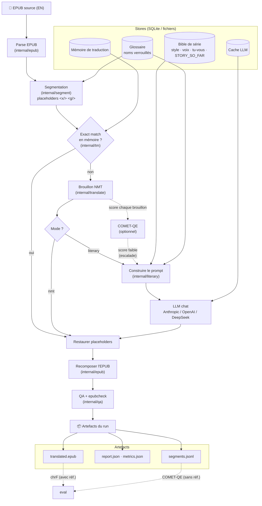

# epub-translator

Go-based EPUB EN->FR translation pipeline.

## Comment ça marche (vue d'ensemble)

L'EPUB est parsé puis segmenté (en isolant le markup inline derrière des
placeholders). Chaque segment passe par la mémoire de traduction (réutilisation
exacte), sinon un brouillon NMT. En mode **littéraire**, un LLM retraduit à
partir d'un prompt construit depuis la **bible de série** (style, voix, tu/vous,
résumés `STORY_SO_FAR`) et du glossaire ; COMET-QE peut n'escalader que les
brouillons faibles. On restaure les placeholders, on recompose l'EPUB, on valide
(QA + epubcheck), et on écrit les artefacts. L'évaluation (chrF / COMET-QE) se
fait à part sur les artefacts.



## Documentation

| Doc | Pour quoi |
|---|---|
| **[docs/INSTALLATION.md](docs/INSTALLATION.md)** | télécharger, installer, configurer, build, services (NMT, COMET) — natif & Docker |
| **[docs/guide-traduction.md](docs/guide-traduction.md)** | traduire un livre pas à pas (modes NMT & littéraire) |
| **[docs/evaluation-qualite.md](docs/evaluation-qualite.md)** | mesurer la qualité (chrF, COMET-QE) et relire **ligne par ligne** |
| **[docs/ameliorer-traduction.md](docs/ameliorer-traduction.md)** | améliorer la traduction (glossaire, bible, garde-fous de style) |
| [docs/ARCHITECTURE.md](docs/ARCHITECTURE.md) | architecture & contraintes (source de vérité) |

> Nouveau venu : commence par **INSTALLATION** → **guide-traduction** →
> **evaluation-qualite**. Le reste de ce README est une référence rapide.

## Prerequisites
- Go (latest stable)
- Java runtime (`>=21`, tested with Java 25) for `epubcheck`
- `just` command runner
- `ripgrep` (`rg`) for helper recipe output
- `golangci-lint`

## Local Setup
1. Copy env template:
   ```bash
   cp .env.example .env.local
   ```
2. Edit `.env.local` with your NMT endpoint and API keys.
3. Keep `.env.local` as trusted local config only (`KEY=VALUE` lines).

## Run
```bash
just preflight
just run ./books/source.epub ./runs
```

### Literary mode with a series bible
Seed or refresh the series bible first:
```bash
epub-translator style-profile --input ./books/volume-01.epub --series my-series --samples 3
```

Then run the sequential literary pipeline:
```bash
epub-translator run \
  --input ./books/volume-01.epub \
  --output-dir ./runs \
  --source-lang en \
  --target-lang fr \
  --mode literary \
  --series my-series
```

Literary mode still uses NMT/translation memory for drafts, then calls the
configured chat model with the persisted bible, glossary, and adjacent chapter
context. Configure `EPUB_TRANSLATOR_NARRATIVE_PATH`,
`EPUB_TRANSLATOR_LLM_CHAT_PROVIDER` (`anthropic` | `openai` | `deepseek`),
`EPUB_TRANSLATOR_LLM_BASE_URL`, `EPUB_TRANSLATOR_LLM_MODEL`, and
`EPUB_TRANSLATOR_LLM_API_KEY`.

By default the bible is **frozen for the run**: every chapter sees the same bible,
so prompts (and the Anthropic prompt cache on the system prefix) stay stable and
re-runs are reproducible/free (served from the SQLite LLM cache). Pass
`--update-bible` to let the bible evolve chapter-by-chapter within the run
(better intra-volume consistency, but re-runs re-translate). Recommended series
workflow: `style-profile` once to seed the bible, then `run` frozen; for later
volumes, reuse the same `--series` (the bible carries over) and enrich it with
`style-profile --merge` (adds new characters/terms/address rules without
overwriting prior volumes — without `--merge`, style-profile replaces the bible). The Anthropic adapter sets a `cache_control` breakpoint on the bible/style
prefix; cache read/creation tokens are reported in `report.json` and
`metrics.json` (`translation_llm_cache_read_tokens`, etc.).

### Self-hosted local NMT (no external service)
The default `EPUB_TRANSLATOR_NMT_ENDPOINT` points at a bundled local NMT dev
server so the pipeline runs end-to-end with no external dependency. Start it in
another terminal:
```bash
just nmt-dev        # serves the dev NMT on :8081 (dictionary EN→FR)
```
This dev server is for local development only — it does dictionary-based,
word-level substitution and preserves placeholder tokens. With Docker, `just up`
starts the `nmt` service and the `app` together automatically.

### Quality estimation with COMET-QE (self-hosted)
The pipeline can score each NMT draft (reference-free) and escalate only the
weakest segments to the LLM. It expects a COMET scoring service with this
contract:
```
POST <COMET_ENDPOINT>
  { "samples": [ {"src": "...", "mt": "...", "ref": "..."} ] }   # ref optional (QE)
→ { "scores": [0.83, ...] }
```
A minimal CometKiwi (reference-free) service — `comet_service.py`:
```python
from comet import download_model, load_from_checkpoint
from fastapi import FastAPI
model = load_from_checkpoint(download_model("Unbabel/wmt22-cometkiwi-da"))  # gated on HF
app = FastAPI()
@app.post("/score")
async def score(body: dict):
    data = [{"src": s["src"], "mt": s["mt"]} for s in body["samples"]]  # QE: ignore ref
    out = model.predict(data, batch_size=8, gpus=0)                     # gpus=0 → CPU
    return {"scores": [float(x) for x in out.scores]}
```
Run it with [`uv`](https://docs.astral.sh/uv/) — it pins a compatible Python and
fetches deps (avoids the bleeding-edge-Python dependency conflicts the COMET ML
stack hits on 3.13/3.14):
```bash
# one-time, if the model is gated: accept the license on its HF page, then
uv run --python 3.12 --with "huggingface-hub<1.0" -- huggingface-cli login

uv run --python 3.12 \
  --with "unbabel-comet>=2.2" --with "huggingface-hub<1.0" \
  --with fastapi --with "uvicorn[standard]" \
  -- python -m uvicorn comet_service:app --host 127.0.0.1 --port 8000
```
Use **Python 3.12** and pin **`huggingface-hub<1.0`** (required by `transformers`).
A plain `pip`/`venv` works too, but only on a supported Python.
Enable it:
```bash
EPUB_TRANSLATOR_COMET_ENDPOINT=http://localhost:8000/score
EPUB_TRANSLATOR_ESCALATE_BELOW_SCORE=0.80   # escalate drafts scoring below this
```
The per-book average score lands in `report.json` (`avg_quality_score`) and
`metrics.json` (`translation_quality_score`).

To score an **already-translated** run reference-free (no human reference needed
— ideal when your only reference is a different edition, e.g. web-novel vs light
novel), point `eval` at its `segments.jsonl` with a COMET service running:
```bash
EPUB_TRANSLATOR_COMET_ENDPOINT=http://localhost:8000/score \
  epub-translator eval --segments runs/<run-id>/segments.jsonl
# → COMET-QE avg = 0.xx (min ... over N segments); writes qe-eval-report.json
```

### Real translations with LibreTranslate (self-hosted)
For actual EN→FR translation, run a real local engine. LibreTranslate is the
simplest to self-host:
```bash
# Docker (first start downloads the en→fr model):
docker compose --profile real-nmt up libretranslate
# or standalone:
docker run -ti -p 5000:5000 libretranslate/libretranslate --load-only en,fr
```
Then point the app at it:
```bash
EPUB_TRANSLATOR_NMT_PROVIDER=libretranslate
EPUB_TRANSLATOR_NMT_ENDPOINT=http://localhost:5000/translate
```
The adapter sends `format=html`, so inline placeholder tokens survive
translation. Heavier engines (OPUS-MT, NLLB-200) can be used behind the same
`libretranslate`-compatible contract or by adding a small adapter.

## Docker Local Run
Prepare local folders and input file:
```bash
mkdir -p books runs data
# Place your source file at: ./books/source.epub
```

Build image:
```bash
just docker-build
```

Run translation in container:
```bash
just up
```

What happens:
- `docker compose` starts the `app` service from `docker-compose.yml`.
- `.env.local` is loaded into the container runtime.
- Local folders are mounted:
  - `./books` -> `/app/books`
  - `./runs` -> `/app/runs`
  - `./data` -> `/app/data`
- The container executes:
  - `epub-translator run --input /app/books/source.epub --output-dir /app/runs --source-lang en --target-lang fr`

View logs:
```bash
docker compose logs -f app
```

Stop and clean compose resources:
```bash
just down
```

## Test
```bash
just test
just fuzz
```

## Code Validation
```bash
just preflight
just fmt
just lint
just fuzz
just ci-local
just check
```

`just fuzz` runs all local fuzz tests across packages and is intentionally not included in CI to keep pipeline runtime predictable.

## CI and PR Workflow
- GitHub Actions workflow: `.github/workflows/ci.yml`
- Pull request template: `.github/pull_request_template.md`
- CI runs format check, lint, and tests automatically once `go.mod` exists.

## Notes
- **End-to-end translation guide (FR): [`docs/guide-traduction.md`](docs/guide-traduction.md)** — setup, LLM providers, literary mode, series bible, cost, eval.
- Runtime config is env-only via `github.com/kelseyhightower/envconfig`.
- `Justfile` recipes source `.env.local` before running commands.
- Architecture decisions live in `docs/ARCHITECTURE.md`.
- Milestone plans live in `docs/milestones/`.
- RFCs live in `docs/rfcs/`.
