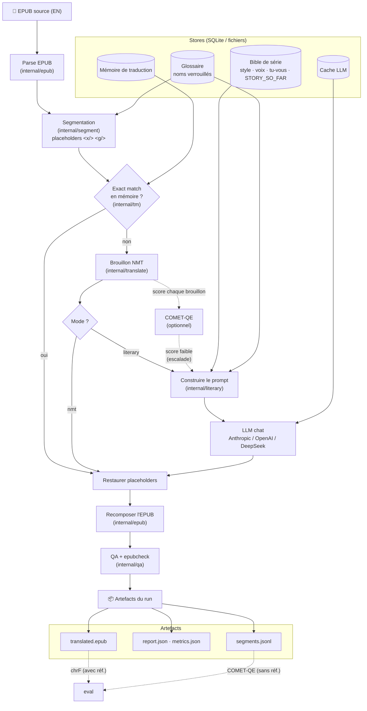

# epub-translator

Go-based EPUB EN->FR translation pipeline.

## Comment ça marche (vue d'ensemble)

L'EPUB est parsé puis segmenté (en isolant le markup inline derrière des
placeholders). Chaque segment passe par la mémoire de traduction (réutilisation
exacte), sinon un brouillon NMT. En mode **littéraire**, un LLM retraduit à
partir d'un prompt construit depuis la **bible de série** (style, voix, tu/vous,
résumés `STORY_SO_FAR`) et du glossaire ; COMET-QE peut n'escalader que les
brouillons faibles. On restaure les placeholders, on recompose l'EPUB, on valide
(QA + epubcheck), et on écrit les artefacts. L'évaluation (chrF / COMET-QE) se
fait à part sur les artefacts.



## Documentation

| Doc | Pour quoi |
|---|---|
| **[docs/comprendre-le-projet.html](docs/comprendre-le-projet.html)** | 🎬 le projet illustré : concepts, logique, diagrammes, exemples animés, carte du code, comment étendre |
| **[docs/utilisation.html](docs/utilisation.html)** | 🎬 le mode d'emploi illustré : setup, services, chaque commande et flag avec sa conséquence, codes de sortie |
| **[docs/INSTALLATION.md](docs/INSTALLATION.md)** | télécharger, installer, configurer, build, services (NMT, COMET) — natif & Docker |
| **[docs/guide-traduction.md](docs/guide-traduction.md)** | traduire un livre pas à pas (modes NMT & littéraire) |
| **[docs/evaluation-qualite.md](docs/evaluation-qualite.md)** | mesurer la qualité (chrF, COMET-QE) et relire **ligne par ligne** |
| **[docs/ameliorer-traduction.md](docs/ameliorer-traduction.md)** | améliorer la traduction (glossaire, bible, garde-fous de style) |
| [docs/ARCHITECTURE.md](docs/ARCHITECTURE.md) | architecture & contraintes (source de vérité) |
| [docs/rfc-0007-google-translate.html](docs/rfc-0007-google-translate.html) | RFC 0007 illustrée — brouillon Google, garde-fou par tokens, contexte LLM (diagrammes) |

> Nouveau venu : commence par les deux documents illustrés
> (**comprendre-le-projet** → **utilisation**), puis **INSTALLATION** →
> **guide-traduction** → **evaluation-qualite** pour le détail en texte. Le reste
> de ce README est une référence rapide.

## Prerequisites
The toolchain is declared in [`mise.toml`](mise.toml) — Go, Java (temurin 21, for
`epubcheck`), `just`, `ripgrep`, `golangci-lint`, Python and `uv`. Two tools stay
manual: `mise` itself and the 1Password CLI.

```bash
brew install mise 1password-cli
```

## Local Setup
1. Install the toolchain:
   ```bash
   mise trust && mise install
   ```
2. Copy the env template:
   ```bash
   cp .env.example .env.local
   ```
3. Edit `.env.local` with your NMT endpoint and **non-secret** settings. Keep it
   to `KEY=VALUE` lines.
4. Leave the API keys empty there: they live in a 1Password vault, referenced by
   the committed [`.env.op`](.env.op) and injected per command by `op run`. The
   recipes that call a provider are wrapped; `estimate`, `glossary-suggest` and
   `eval-ref` are not, so they never ask for a credential.
5. `just preflight` checks all of the above at once.

## Run
```bash
just preflight
just run ./books/source.epub ./runs
```

### Literary mode with a series bible
Build the bible first, from every volume of the series. This is a job of its
own, run once per published volume rather than once per translation:
```bash
epub-translator series-bible --input-dir ./books/my-series --series my-series --samples 8
```
It seeds style, character voices and address rules from **all** volumes, then
writes one synopsis per volume via map-reduce (one summary per chapter, then one
reduction over those summaries). It stores one bible per volume — `my-series@volume-01`,
`my-series@volume-02`, … — each holding the synopses of volumes 1..N only, so the
model never receives the ending of a story it is rendering the beginning of. The
bare `my-series` ID is the newest volume's bible.

Then run the sequential literary pipeline against the frozen bible:
```bash
epub-translator run \
  --input ./books/my-series/volume-01.epub \
  --output-dir ./runs \
  --source-lang en \
  --target-lang fr \
  --mode literary \
  --series my-series@volume-01
```

Literary mode still uses NMT/translation memory for drafts, then calls the
configured chat model with the persisted bible, glossary, and adjacent chapter
context. Configure `EPUB_TRANSLATOR_NARRATIVE_PATH`,
`EPUB_TRANSLATOR_LLM_CHAT_PROVIDER` (`anthropic` | `openai` | `deepseek`),
`EPUB_TRANSLATOR_LLM_BASE_URL`, `EPUB_TRANSLATOR_LLM_MODEL`, and
`EPUB_TRANSLATOR_LLM_API_KEY`.

The bible is an **input** to a run, never an output: every chapter sees the same
bible, so prompts (and the Anthropic prompt cache on the system prefix) stay
stable and re-runs are reproducible and free (served from the SQLite LLM cache).
Regenerate it with `series-bible` when a new volume is published — that
invalidates the LLM cache once, by design, rather than once per chapter.

`--update-bible` still exists but is **not part of any recommended workflow**: it
is mutually exclusive with a cached prefix. Letting the bible evolve
chapter-by-chapter rewrites the cacheable prefix once per chapter instead of
once per run (4.33 $ per volume against 0.25–0.41 $), and leaves the bible on
disk different from the one the next run starts with, so re-runs stop being free
and stop being reproducible.

`style-profile` remains available to seed style/voices/address from a single
volume, with `--merge` to enrich rather than replace. `series-bible` supersedes
it for series work. The Anthropic adapter sets a `cache_control` breakpoint on
the bible/style prefix; cache read/creation tokens are reported in `report.json`
and `metrics.json` (`translation_llm_cache_read_tokens`, etc.).

### Self-hosted local NMT (no external service)
The default `EPUB_TRANSLATOR_NMT_ENDPOINT` points at a bundled local NMT dev
server so the pipeline runs end-to-end with no external dependency. Start it in
another terminal:
```bash
just nmt-dev        # serves the dev NMT on :8081 (dictionary EN→FR)
```
This dev server is for local development only — it does dictionary-based,
word-level substitution and preserves placeholder tokens. With Docker, `just up`
starts the `nmt` service and the `app` together automatically.

### Quality estimation with COMET-QE (self-hosted)
The pipeline can score each NMT draft (reference-free) and escalate only the
weakest segments to the LLM. It expects a COMET scoring service with this
contract:
```
POST <COMET_ENDPOINT>
  { "samples": [ {"src": "...", "mt": "...", "ref": "..."} ] }   # ref optional (QE)
→ { "scores": [0.83, ...] }
```
A minimal CometKiwi (reference-free) service — `comet_service.py`:
```python
from comet import download_model, load_from_checkpoint
from fastapi import FastAPI
model = load_from_checkpoint(download_model("Unbabel/wmt22-cometkiwi-da"))  # gated on HF
app = FastAPI()
@app.post("/score")
async def score(body: dict):
    data = [{"src": s["src"], "mt": s["mt"]} for s in body["samples"]]  # QE: ignore ref
    out = model.predict(data, batch_size=8, gpus=0)                     # gpus=0 → CPU
    return {"scores": [float(x) for x in out.scores]}
```
Run it with [`uv`](https://docs.astral.sh/uv/) — it pins a compatible Python and
fetches deps (avoids the bleeding-edge-Python dependency conflicts the COMET ML
stack hits on 3.13/3.14):
```bash
# one-time, if the model is gated: accept the license on its HF page, then
uv run --python 3.12 --with "huggingface-hub<1.0" -- huggingface-cli login

uv run --python 3.12 \
  --with "unbabel-comet>=2.2" --with "huggingface-hub<1.0" \
  --with fastapi --with "uvicorn[standard]" \
  -- python -m uvicorn comet_service:app --host 127.0.0.1 --port 8000
```
Use **Python 3.12** and pin **`huggingface-hub<1.0`** (required by `transformers`).
A plain `pip`/`venv` works too, but only on a supported Python.
Enable it:
```bash
EPUB_TRANSLATOR_COMET_ENDPOINT=http://localhost:8000/score
EPUB_TRANSLATOR_ESCALATE_BELOW_SCORE=0.80   # escalate drafts scoring below this
```
The per-book average score lands in `report.json` (`avg_quality_score`) and
`metrics.json` (`translation_quality_score`).

To score an **already-translated** run reference-free (no human reference needed
— ideal when your only reference is a different edition, e.g. web-novel vs light
novel), point `eval` at its `segments.jsonl` with a COMET service running:
```bash
EPUB_TRANSLATOR_COMET_ENDPOINT=http://localhost:8000/score \
  epub-translator eval --segments runs/<run-id>/segments.jsonl
# → COMET-QE avg = 0.xx (min ... over N segments); writes qe-eval-report.json
```

### Real translations with Google Cloud Translation (recommended)
The best draft quality, and free at roughly one volume per month:
```bash
EPUB_TRANSLATOR_NMT_PROVIDER=google
EPUB_TRANSLATOR_NMT_API_KEY=<Cloud Translation API key>
EPUB_TRANSLATOR_NMT_FREE_CHARS_PER_MONTH=500000
EPUB_TRANSLATOR_COST_PER_1000_CHARS_USD=0.02          # 20 $ / M characters
```
This targets Cloud Translation **v2 (Basic)**, which authenticates with an API
key — no service account to plumb through Docker and CI, and it supplies the
public host itself, so `NMT_ENDPOINT` can stay empty. The adapter sends
`format=html` and batches a chapter's segments (up to 128 texts or 5000
characters per request). The GCP project needs billing enabled even for the free
tier, and the free 500,000 characters per month are shared between Basic and
Advanced across the whole project.

### Real translations with LibreTranslate (self-hosted)
To keep the draft local instead, LibreTranslate is the simplest to self-host:
```bash
# Docker (first start downloads the en→fr model):
docker compose --profile real-nmt up libretranslate
# or standalone:
docker run -ti -p 5000:5000 libretranslate/libretranslate --load-only en,fr
```
Then point the app at it:
```bash
EPUB_TRANSLATOR_NMT_PROVIDER=libretranslate
EPUB_TRANSLATOR_NMT_ENDPOINT=http://localhost:5000/translate
```
The adapter sends `format=html`, so inline placeholder tokens survive
translation. Heavier engines (OPUS-MT, NLLB-200) can be used behind the same
`libretranslate`-compatible contract or by adding a small adapter.

## Docker Local Run
Prepare local folders and input file:
```bash
mkdir -p books runs data
# Place your source file at: ./books/source.epub
```

Build image:
```bash
just docker-build
```

Run translation in container:
```bash
just up
```

What happens:
- `docker compose` starts the local **Temporal dev server** (`temporal`, gRPC
  `:7233`, Web UI `:8233`) and the `app` service from `docker-compose.yml`.
  Temporal is the durable execution engine for `run`/`batch` (RFC 0009); its UI
  is at http://localhost:8233 (`just temporal-ui` opens it).
- `.env.local` is loaded into the container runtime.
- Local folders are mounted:
  - `./books` -> `/app/books`
  - `./runs` -> `/app/runs`
  - `./data` -> `/app/data`
- The container executes:
  - `epub-translator run --input /app/books/source.epub --output-dir /app/runs --source-lang en --target-lang fr`

View logs:
```bash
docker compose logs -f app
```

Stop and clean compose resources:
```bash
just down
```

## Test
```bash
just test
just fuzz
```

## Code Validation
```bash
just preflight
just fmt
just lint
just fuzz
just ci-local
just check
```

`just fuzz` runs all local fuzz tests across packages and is intentionally not included in CI to keep pipeline runtime predictable.

## CI and PR Workflow
- GitHub Actions workflow: `.github/workflows/ci.yml`
- Pull request template: `.github/pull_request_template.md`
- CI runs format check, lint, and tests automatically once `go.mod` exists.

## Notes
- **End-to-end translation guide (FR): [`docs/guide-traduction.md`](docs/guide-traduction.md)** — setup, LLM providers, literary mode, series bible, cost, eval.
- Runtime config is env-only via `github.com/kelseyhightower/envconfig`.
- `Justfile` recipes source `.env.local` before running commands.
- Architecture decisions live in `docs/ARCHITECTURE.md`.
- Milestone plans live in `docs/milestones/`.
- RFCs live in `docs/rfcs/`.
