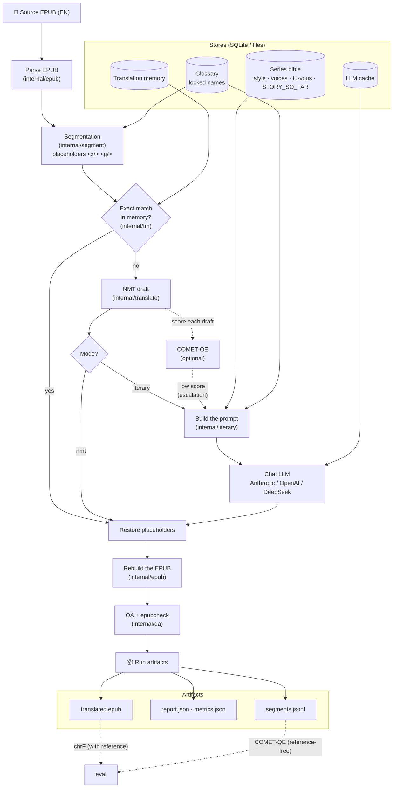

# tomeshift

[](https://github.com/ECecillo/tomeshift/actions/workflows/ci.yml)
[](LICENSE)


**tomeshift translates EPUB books from English to French without breaking
them, and only pays for LLM tokens where they make a difference.**

A book is parsed, split into segments with its inline markup locked behind
placeholders, and drafted by a cheap machine-translation engine. Exact repeats
come from a translation memory for free. Only the drafts a quality estimator
scores as weak, or a whole book in *literary* mode, go to an LLM, with a
per-series "bible" (style guide, character voices, tu/vous rules, volume
summaries) so that names and voices stay consistent across volumes. The EPUB is
then rebuilt, checked, and every run leaves a report of what it did and what it
cost.

It is a single Go binary with SQLite storage (pure Go, no CGO), a dev NMT server
for offline runs, and an optional Python COMET-QE scoring service.

## Quickstart: translate a public-domain book offline

```bash
git clone https://github.com/ECecillo/tomeshift && cd tomeshift
go build -o bin/tomeshift ./cmd/tomeshift
go build -o bin/nmt-devserver ./cmd/nmt-devserver

mkdir -p books
curl -L -o books/alice.epub https://www.gutenberg.org/ebooks/11.epub3.images

./bin/nmt-devserver &   # dev-only dictionary EN→FR engine on :8081
TOMESHIFT_NMT_ENDPOINT=http://localhost:8081/translate \
  ./bin/tomeshift run --input books/alice.epub --output-dir runs \
    --source-lang en --target-lang fr \
    --glossary glossary.example.json --run-id alice
# run alice completed: 797 segments, 14 tm hits, 783 nmt, output=runs/alice/translated.epub
```

Run the same command again with `--resume`: all 797 segments come from the
translation memory and no engine is called. `runs/alice/` holds
`translated.epub`, `report.json`, `metrics.json`, `segments.jsonl` and
`logs.ndjson`.

The dev server substitutes words from a dictionary, which is enough to exercise
the whole pipeline but not to read the result. Real drafts come from
[Google Cloud Translation or LibreTranslate](#real-translations-with-google-cloud-translation-recommended),
and literary quality comes from an LLM
([literary mode](#literary-mode-with-a-series-bible)).

## How it works



## Design decisions

- **Markup never reaches a translation engine.** Inline tags become numbered
  placeholder tokens before translation and are restored afterwards. QA reports
  the restore ratio for every run, and the tokenize/restore round trip is fuzzed
  (`FuzzTokenizeRestore`).
- **Never pay twice for the same sentence.** Segments are keyed by the SHA-256
  of their normalized text. Exact hits skip translation, LLM completions are
  cached, and `--resume` on a finished book makes no provider call (covered by
  `TestRun_ResumeIsIdempotent`).
- **Budgets are enforced before spending.** `estimate` projects the cost of a
  book. Daily, monthly and per-book caps are checked against the work that is
  *left* after translation-memory hits, and every attempt is written to an
  append-only spend ledger.
- **Fail loudly instead of degrading silently.** Retries use bounded backoff and
  stop when the context is cancelled. An HTTP 429 becomes `ErrRateLimited` and
  stops the chapter instead of shipping raw drafts as if they were final. A
  truncated LLM batch is retried as two smaller batches. SIGINT/SIGTERM and a
  per-book timeout shut a run down cleanly.
- **Stable prompts.** A series bible is an input that stays frozen during a run,
  one per volume, so the model never sees the end of a story while translating
  its beginning. The prompt prefix stays byte-identical, so the provider's
  prompt cache and the local LLM cache make re-runs free.
- **Concurrency where it is measured to matter.** Books and chapters are
  processed sequentially on purpose: the decision is to measure before adding
  parallelism (chapter-level parallelism for the LLM pass is the next
  candidate). Shared state is already safe for concurrent use: the series-bible
  store uses optimistic concurrency (a version column with compare-and-swap
  updates), and tests exercise it with concurrent writers.
- **Observable runs.** Structured JSON logs (zap) carry `run_id` and `book_id`,
  and `metrics.json` follows a fixed contract (`docs/ARCHITECTURE.md` §10).

## Project status

- The NMT pipeline (parse → segment → TM → draft → QA → rebuild) and literary
  mode with series bibles are implemented and tested: 299 tests, 2 fuzz
  targets, race detector in CI.
- In progress on branch `refactor/to-temporal` (RFC 0009): the pipeline stages
  are decoupled behind ports, ahead of an optional Temporal execution engine.
- Planned: a service mode with queue workers and PostgreSQL
  (`docs/milestones/M4-production-hardening.md`).

## Documentation

| Doc | What for |
|---|---|
| **[docs/understanding-the-project.html](docs/understanding-the-project.html)** | The project, illustrated: concepts, data flow, diagrams, animated examples, code map, how to extend it |
| **[docs/usage.html](docs/usage.html)** | Illustrated user manual: setup, services, every command and flag with its effect, exit codes |
| **[docs/INSTALLATION.md](docs/INSTALLATION.md)** | Install, configure, build and run the services (NMT, COMET), native or Docker |
| **[docs/translation-guide.md](docs/translation-guide.md)** | Translate a book step by step (NMT and literary modes) |
| **[docs/quality-evaluation.md](docs/quality-evaluation.md)** | Measure quality (chrF, COMET-QE) and review line by line |
| **[docs/improving-translations.md](docs/improving-translations.md)** | Improve a translation: glossary, bible, style guardrails |
| [docs/ARCHITECTURE.md](docs/ARCHITECTURE.md) | Architecture and constraints (source of truth) |
| [docs/rfcs/](docs/rfcs/) | Design decisions, one RFC each |
| [docs/rfc-0007-google-translate.html](docs/rfc-0007-google-translate.html) | RFC 0007, illustrated: Google draft, token-based cost guard, LLM context |

> New here? Start with the two illustrated documents
> (**understanding-the-project** → **usage**), then **INSTALLATION** →
> **translation-guide** → **quality-evaluation** for the details in text. The
> rest of this README is a quick reference.

## Prerequisites
The toolchain is declared in [`mise.toml`](mise.toml) — Go, Java (temurin 21, for
`epubcheck`), `just`, `ripgrep`, `golangci-lint`, Python and `uv`. Two tools stay
manual: `mise` itself and the 1Password CLI.

```bash
brew install mise 1password-cli
```

## Local Setup
1. Install the toolchain:
   ```bash
   mise trust && mise install
   ```
2. Copy the env template:
   ```bash
   cp .env.example .env.local
   ```
3. Edit `.env.local` with your NMT endpoint and **non-secret** settings. Keep it
   to `KEY=VALUE` lines.
4. Leave the API keys empty there. Either export them in your shell, or keep
   them in a 1Password vault referenced by the committed [`.env.op`](.env.op)
   and injected per command by `op run`. The recipes that call a provider are
   wrapped; `estimate`, `glossary-suggest` and `eval-ref` are not, so they never
   ask for a credential.
5. `just preflight` checks all of the above at once.

## Run
```bash
just preflight
just run ./books/source.epub ./runs
```

### Literary mode with a series bible
Build the bible first, from every volume of the series. This is a job of its
own, run once per published volume rather than once per translation:
```bash
tomeshift series-bible --input-dir ./books/my-series --series my-series --samples 8
```
It seeds style, character voices and address rules from **all** volumes, then
writes one synopsis per volume via map-reduce (one summary per chapter, then one
reduction over those summaries). It stores one bible per volume — `my-series@volume-01`,
`my-series@volume-02`, … — each holding the synopses of volumes 1..N only, so the
model never receives the ending of a story it is rendering the beginning of. The
bare `my-series` ID is the newest volume's bible.

Then run the sequential literary pipeline against the frozen bible:
```bash
tomeshift run \
  --input ./books/my-series/volume-01.epub \
  --output-dir ./runs \
  --source-lang en \
  --target-lang fr \
  --mode literary \
  --series my-series@volume-01
```

Literary mode still uses NMT/translation memory for drafts, then calls the
configured chat model with the persisted bible, glossary, and adjacent chapter
context. Configure `TOMESHIFT_NARRATIVE_PATH`,
`TOMESHIFT_LLM_CHAT_PROVIDER` (`anthropic` | `openai` | `deepseek`),
`TOMESHIFT_LLM_BASE_URL`, `TOMESHIFT_LLM_MODEL`, and
`TOMESHIFT_LLM_API_KEY`.

The bible is an **input** to a run, never an output: every chapter sees the same
bible, so prompts (and the Anthropic prompt cache on the system prefix) stay
stable and re-runs are reproducible and free (served from the SQLite LLM cache).
Regenerate it with `series-bible` when a new volume is published — that
invalidates the LLM cache once, by design, rather than once per chapter.

`--update-bible` still exists but is **not part of any recommended workflow**: it
is mutually exclusive with a cached prefix. Letting the bible evolve
chapter-by-chapter rewrites the cacheable prefix once per chapter instead of
once per run (4.33 $ per volume against 0.25–0.41 $), and leaves the bible on
disk different from the one the next run starts with, so re-runs stop being free
and stop being reproducible.

`style-profile` remains available to seed style/voices/address from a single
volume, with `--merge` to enrich rather than replace. `series-bible` supersedes
it for series work. The Anthropic adapter sets a `cache_control` breakpoint on
the bible/style prefix; cache read/creation tokens are reported in `report.json`
and `metrics.json` (`translation_llm_cache_read_tokens`, etc.).

### Self-hosted local NMT (no external service)
`.env.example` points `TOMESHIFT_NMT_ENDPOINT` at a bundled local NMT dev
server, so the pipeline runs end-to-end with no external dependency. Start it in
another terminal:
```bash
just nmt-dev        # serves the dev NMT on :8081 (dictionary EN→FR)
```
This dev server is for local development only — it does dictionary-based,
word-level substitution and preserves placeholder tokens. With Docker, `just up`
starts the `nmt` service and the `app` together automatically.

### Quality estimation with COMET-QE (self-hosted)
The pipeline can score each NMT draft (reference-free) and escalate only the
weakest segments to the LLM. It expects a COMET scoring service with this
contract:
```
POST <COMET_ENDPOINT>
  { "samples": [ {"src": "...", "mt": "...", "ref": "..."} ] }   # ref optional (QE)
→ { "scores": [0.83, ...] }
```
A minimal CometKiwi (reference-free) service — `comet_service.py`:
```python
from comet import download_model, load_from_checkpoint
from fastapi import FastAPI
model = load_from_checkpoint(download_model("Unbabel/wmt22-cometkiwi-da"))  # gated on HF
app = FastAPI()
@app.post("/score")
async def score(body: dict):
    data = [{"src": s["src"], "mt": s["mt"]} for s in body["samples"]]  # QE: ignore ref
    out = model.predict(data, batch_size=8, gpus=0)                     # gpus=0 → CPU
    return {"scores": [float(x) for x in out.scores]}
```
Run it with [`uv`](https://docs.astral.sh/uv/) — it pins a compatible Python and
fetches deps (avoids the bleeding-edge-Python dependency conflicts the COMET ML
stack hits on 3.13/3.14):
```bash
# one-time, if the model is gated: accept the license on its HF page, then
uv run --python 3.12 --with "huggingface-hub<1.0" -- huggingface-cli login

uv run --python 3.12 \
  --with "unbabel-comet>=2.2" --with "huggingface-hub<1.0" \
  --with fastapi --with "uvicorn[standard]" \
  -- python -m uvicorn comet_service:app --host 127.0.0.1 --port 8000
```
Use **Python 3.12** and pin **`huggingface-hub<1.0`** (required by `transformers`).
A plain `pip`/`venv` works too, but only on a supported Python.
Enable it:
```bash
TOMESHIFT_COMET_ENDPOINT=http://localhost:8000/score
TOMESHIFT_ESCALATE_BELOW_SCORE=0.80   # escalate drafts scoring below this
```
The per-book average score lands in `report.json` (`avg_quality_score`) and
`metrics.json` (`translation_quality_score`).

To score an **already-translated** run reference-free (no human reference needed
— ideal when your only reference is a different edition, e.g. web-novel vs light
novel), point `eval` at its `segments.jsonl` with a COMET service running:
```bash
TOMESHIFT_COMET_ENDPOINT=http://localhost:8000/score \
  tomeshift eval --segments runs/<run-id>/segments.jsonl
# → COMET-QE avg = 0.xx (min ... over N segments); writes qe-eval-report.json
```

### Real translations with Google Cloud Translation (recommended)
The best draft quality, and free at roughly one volume per month:
```bash
TOMESHIFT_NMT_PROVIDER=google
TOMESHIFT_NMT_API_KEY=<Cloud Translation API key>
TOMESHIFT_NMT_FREE_CHARS_PER_MONTH=500000
TOMESHIFT_COST_PER_1000_CHARS_USD=0.02          # 20 $ / M characters
```
This targets Cloud Translation **v2 (Basic)**, which authenticates with an API
key — no service account to plumb through Docker and CI, and it supplies the
public host itself, so `NMT_ENDPOINT` can stay empty. The adapter sends
`format=html` and batches a chapter's segments (up to 128 texts or 5000
characters per request). The GCP project needs billing enabled even for the free
tier, and the free 500,000 characters per month are shared between Basic and
Advanced across the whole project.

### Real translations with LibreTranslate (self-hosted)
To keep the draft local instead, LibreTranslate is the simplest to self-host:
```bash
# Docker (first start downloads the en→fr model):
docker compose --profile real-nmt up libretranslate
# or standalone:
docker run -ti -p 5000:5000 libretranslate/libretranslate --load-only en,fr
```
Then point the app at it:
```bash
TOMESHIFT_NMT_PROVIDER=libretranslate
TOMESHIFT_NMT_ENDPOINT=http://localhost:5000/translate
```
The adapter sends `format=html`, so inline placeholder tokens survive
translation. Heavier engines (OPUS-MT, NLLB-200) can be used behind the same
`libretranslate`-compatible contract or by adding a small adapter.

## Docker Local Run
Prepare local folders and input file:
```bash
mkdir -p books runs data
# Place your source file at: ./books/source.epub
```

Build image:
```bash
just docker-build
```

Run translation in container:
```bash
just up
```

What happens:
- `docker compose` starts the `app` service from `docker-compose.yml`.
- `.env.local` is loaded into the container runtime.
- Local folders are mounted:
  - `./books` -> `/app/books`
  - `./runs` -> `/app/runs`
  - `./data` -> `/app/data`
- The container executes:
  - `tomeshift run --input /app/books/source.epub --output-dir /app/runs --source-lang en --target-lang fr`

View logs:
```bash
docker compose logs -f app
```

Stop and clean compose resources:
```bash
just down
```

## Test
```bash
just test
just fuzz
```

## Code Validation
```bash
just preflight
just fmt
just lint
just fuzz
just ci-local
just check
```

CI runs `gofmt`, golangci-lint, build, vet, the tests with the race detector
and a 15-second smoke run of both fuzz targets. `just fuzz` runs the full local
fuzz suite.

## Notes
- Runtime config is env-only via `github.com/kelseyhightower/envconfig`.
- `Justfile` recipes source `.env.local` before running commands.
- Architecture decisions live in `docs/ARCHITECTURE.md`, milestone plans in
  `docs/milestones/`, RFCs in `docs/rfcs/`.

## Contributing

Issues and pull requests are welcome. Run `just check` (format, lint, tests,
docs audit) before opening a PR. Do not commit copyrighted books or their
translations: `books/`, `epub/`, `runs/` and `data/` are git-ignored for that
reason.

## License

Apache License 2.0, see [LICENSE](LICENSE) and [NOTICE](NOTICE).

