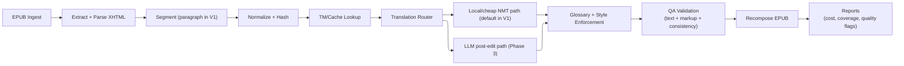

# EPUB English-to-French Translation System Architecture

## 1. Purpose
Build a cost-efficient system that translates EPUB books from English to French while preserving formatting and structure, and minimizing paid LLM token usage.

Planning note:
- Milestone delivery plans are maintained in `docs/milestones/`.
- This document keeps architecture decisions and system design references.

Implementation policy:
- Prefer Go standard library first.
- Introduce third-party packages only when stdlib is insufficient for required behavior or operational needs.
- Approved dependency policy and rationale live in `docs/DEPENDENCIES.md`.

Configuration policy:
- Runtime config is loaded from environment variables into typed structs using `github.com/kelseyhightower/envconfig`.
- Defaults and required settings are declared in config struct tags.
- `.env` overrides are applied by sourcing a selected `.env` file in the shell before running commands.
- `.env` files are trusted local files and must only contain `KEY=VALUE` assignments for app configuration.
- Command orchestration uses `just`/`Justfile` recipes.

## Glossary
- DRM(Digital rights management): technology used to protect digital documents from direct access or modification.
- EPUB: standard file format used to store content such as book.
- LLM(Large Language Model): a program trained on a large amount of data and capable of generating content.
- TM(Translation Memory): A cache of already covered sentences, words our program would already translate.
- NMT(Neural Machine Translation): Specific machine learning type, exclusively used and trained for translation. ([more infos](https://blog.pangeanic.com/fr/quelle-est-la-meilleure-solution-pour-mon-cas-dutilisation-la-traduction-nmt-neuronale-ou-llm-notre-livre-blanc))
- Ruby (EPUB/XHTML markup): annotation markup used to attach pronunciation/reading text to base text (commonly East Asian typography).
  - Example:
    ```xml
    <ruby>漢<rt>かん</rt></ruby>
    ```
  - Impact in this project:
    - If ruby tags are altered incorrectly, text rendering can break in readers.
    - V1 policy is to preserve ruby markup structure as-is (no ruby-specific rewriting logic).

## 2. Scope
- Input: DRM-free `.epub` files in English.
- Output: translated `.epub` in French with valid packaging and preserved styling.
- Translation quality target: publishable draft quality for prose, with optional human post-edit.
- Cost target: keep average translation cost per book predictable and significantly lower than full-book LLM translation.

## 3. Non-Goals (V1)
- OCR for scanned PDFs.
- Real-time web app editor.
- Fully autonomous literary-quality translation with no human review.
- Translation of DRM-protected content.

## 3.1 V1 Scope Profile (Narrowed)
- Translation path: `TM exact match -> NMT -> EPUB rebuild`.
- LLM post-editing is disabled in V1 by default and implemented later in Phase 3.
- Segmentation is paragraph-level in V1 (sentence-aware chunk merging deferred).
- TM supports exact hash matches only in V1 (fuzzy matching deferred).
- QA gate in V1 is limited to placeholder integrity, structural integrity, and `epubcheck` pass.

## 3.2 Unsupported in V1
- EPUBs requiring OCR or image-to-text extraction.
- Complex layout-sensitive content where exact rendering parity is required (advanced tables, MathML-heavy docs, SVG text flow).
- Interactive EPUB features (embedded scripts/forms/media overlays).
- Automatic literary tone rewriting beyond glossary/style constraints.
- Multi-user SaaS workflows (auth, teams, shared projects).

## 4. Core Constraints

### 4.1 Cost Constraints
- Avoid sending full chapter content to premium LLMs.
- Maximize reuse via translation memory (TM) and caching.
- Prefer local or low-cost neural machine translation (NMT) for first pass.
- Escalate to LLM only for low-confidence or high-value segments.

### 4.2 Technical Constraints
- Preserve EPUB validity (`mimetype`, `META-INF/container.xml`, OPF/NCX/nav).
- Preserve inline markup (`<em>`, `<strong>`, links, ruby/footnotes where present).
- Keep paragraph and sentence alignment traceable for QA and re-runs.

### 4.3 Quality Constraints
- Consistent terminology for names, places, and lore.
- Stable tone/register in French across chapters and adapted to the story.
- No missing text, duplicated text, or broken tags after rebuild.

### 4.4 Legal and Policy Constraints
- Only process content the user has rights to translate.
- Respect provider API data-retention and usage policies.
- Protect uploaded content (encryption at rest/in transit if remote services are used).

## 5. High-Level Architecture



## 6. Component Design

### 6.1 Ingestion and EPUB Parser
Responsibilities:
- Unzip EPUB and load manifest/spine.
- Parse XHTML content in spine order.
- Extract translatable nodes while protecting non-translatable nodes (code blocks, references, metadata).

Recommended Go packages:
- `archive/zip` + `encoding/xml` (stdlib) for EPUB packaging and OPF/container parsing.
- `golang.org/x/net/html` for robust XHTML/HTML node parsing and traversal.

Output artifact:
- Ordered list of translation units with IDs:
  - `book_id`, `chapter_id`, `node_path`, `source_text`, `context_prev`, `context_next`, `markup_tokens`.

### 6.2 Segmentation and Normalization
Responsibilities:
- Split text into paragraph-level segments for V1.
- Normalize whitespace/quotes for stable hashing.
- Preserve placeholders for inline tags before translation.

Design rules:
- Target chunk size: one XHTML paragraph-like node per segment in V1.
- Sentence-aware chunking and context windows are Phase 2+.
- Generate stable `segment_hash = sha256(normalized_source_text)`.

### 6.3 Translation Memory (TM) and Cache
Responsibilities:
- Reuse prior translations by exact hash match.
- Fuzzy match support is deferred to Phase 2+.

Storage:
- SQLite (V1) with optional PostgreSQL migration later.

Suggested tables:
- `segments(source_hash PK, source_text, target_text, source_lang, target_lang, engine, quality_score, created_at)`
- `glossary(term_en, term_fr, category, locked)`
- `runs(run_id, book_id, started_at, ended_at, total_segments, cache_hits, llm_calls, estimated_cost)`

### 6.4 Translation Router
Responsibilities:
- Route each segment to the cheapest acceptable path.

Routing policy (V1 default):
1. Exact TM hit -> reuse.
2. Else local/cheap NMT translation.
3. Apply minimal glossary checks for locked proper nouns and QA checks.

Phase 3 routing extension:
- Evaluate confidence/quality heuristics.
- Escalate only flagged segments to LLM post-edit.

### 6.5 LLM Post-Edit Service (Selective)
Responsibilities:
- Improve fluency and style while preserving meaning and placeholders.
- Not active in V1.

Prompt constraints:
- Must preserve placeholder tokens exactly.
- Must follow glossary and style guide.
- Must return strict JSON output (`translated_text`, `notes`, `changed_terms`).

Operational guardrails:
- Rate limiting and budget caps per run.
- Hard stop when monthly budget threshold is reached.

### 6.6 Glossary and Style Enforcement
Responsibilities:
- Enforce canonical translation for proper nouns/terms.
- Apply consistent register (e.g., neutral modern literary French).
- V1 scope: locked proper noun enforcement only (exact mappings).

Implementation pattern:
- Pre-translation: annotate terms/placeholders.
- Post-translation: validate required term mappings.
- Reject or auto-correct violations based on lock level.

### 6.7 QA and Validation
Automated checks:
- Markup integrity: all placeholders restored, no tag loss.
- Coverage: no untranslated source fragments above threshold.
- Consistency: glossary compliance and repeated phrase consistency.
- Structural checks: chapter count, spine order, and nav integrity.

Optional checks:
- Back-translation sampling for semantic drift.
- Language detection for accidental English leftovers.

### 6.8 EPUB Recomposer
Responsibilities:
- Reinsert translated text into original XHTML nodes.
- Rebuild EPUB archive with correct ordering and metadata.
- Validate final EPUB with `epubcheck`.

## 7. Data Flow and Run Lifecycle
1. User submits EPUB + optional glossary/style config.
2. System parses and segments content.
3. TM/cache lookup resolves reusable segments.
4. Router sends unresolved segments to local/cheap MT.
5. QA pipeline validates text and structure.
6. System rebuilds EPUB and emits run report.

Phase 3 extension:
- Flagged subset goes to LLM post-edit before QA.

Run report fields:
- Total segments
- TM hit rate
- MT-only segment count
- LLM-escalated segment count
- Estimated and actual API cost
- QA warnings/errors

## 8. Cost Model and Budget Controls

### 8.1 Cost Levers
- Increase TM hit rate over time (largest long-term savings).
- Keep chunk size small enough to avoid unnecessary context tokens.
- Use batch API modes when available.

Phase 3+:
- Tune escalation threshold to limit LLM usage.

### 8.2 Budget Guardrails
- Per-book budget cap (hard stop).
- Daily and monthly spend caps.
- Max LLM-escalated segment percentage (e.g., 10-20% default).
- Abort run if projected cost exceeds configured cap.

## 9. Deployment Approach

### 9.1 V1 Local CLI (Recommended)
- Go CLI for single-machine runs.
- SQLite for TM.
- Default NMT provider: one HTTP adapter (`EPUB_TRANSLATOR_NMT_PROVIDER=http`) targeting `EPUB_TRANSLATOR_NMT_ENDPOINT`.
- Optional LLM API key is ignored in V1 because LLM path is disabled by default.
- Local container workflow supported via Docker image + `docker-compose` for reproducible host setup.

Pros:
- Low complexity, high privacy, fast iteration.

### 9.2 V2 Service Mode
- Queue-based workers for multiple books.
- Central TM database.
- Observability, retries, and multi-user auth.

## 10. Reliability and Observability
- Structured logs with `run_id`, `chapter_id`, `segment_id`.
- Metrics:
  - `translation_segments_total`
  - `translation_cache_hit_ratio`
  - `translation_llm_escalation_ratio`
  - `translation_cost_usd_total`
  - `epub_validation_failures_total`
- Retry policy for transient API failures with idempotent segment processing.

## 11. Security
- Secrets via environment variables or secret manager.
- Encrypt persisted source/target content where feasible.
- Minimize retention of full original texts in logs.
- Redact sensitive metadata from debug outputs.

## 12. Testing Strategy
- Unit tests: segmentation, placeholder round-trip, glossary enforcement.
- Integration tests: full parse -> translate -> rebuild on fixture EPUBs.
- Regression tests: chapter-level snapshots for consistency.
- Cost tests: synthetic run to verify budget guardrails trigger correctly.

## 13. Key Risks and Mitigations
- Risk: Broken EPUB formatting after translation.
  - Mitigation: placeholder tokenization + strict structural QA + epubcheck gate.
- Risk: Cost spikes from over-escalation to LLM.
  - Mitigation: hard caps, routing thresholds, and pre-run cost projection.
- Risk: Inconsistent term translations.
  - Mitigation: locked glossary and consistency checks.
- Risk: Low literary quality in nuanced passages.
  - Mitigation: selective LLM post-edit and optional human review workflow.

## 14. Suggested Initial Tech Stack
- Language: Go
- Parsing: `archive/zip`, `encoding/xml` (stdlib), `golang.org/x/net/html` (only external parser dependency)
- Storage: SQLite (V1) via `modernc.org/sqlite` (pure Go, required external DB driver)
- Configuration: `github.com/kelseyhightower/envconfig` (env -> typed struct with defaults)
- CLI: stdlib `flag` in V1 (`cobra` only if command surface grows significantly)
- Logging: `go.uber.org/zap` for structured logging (approved exception to stdlib-first policy)
- Command runner: `just` with project `Justfile`
- QA/validation: `epubcheck` integration
- Default NMT integration: HTTP endpoint adapter (local service or remote API)

## 15. Definition of Done (Per Book Run)
- Valid EPUB generated and opens in common readers.
- No critical QA failures (tag loss, missing chapters, broken nav).
- Cost report generated with segment-level accounting.
- Locked glossary term compliance = 100% (V1 hard requirement).
- `epubcheck` exits successfully.
- Placeholder restoration success rate >= 99.5%.
- Untranslated-segment ratio <= 0.5% (excluding configured no-translate blocks).

## 16. Data Schemas (V1)

### 16.1 Translation Unit Schema
```json
{
  "schema_version": 1,
  "run_id": "20260307-123456",
  "book_id": "book-slug",
  "chapter_id": "ch_0001",
  "segment_id": "ch_0001_p_0012",
  "node_path": "/html/body/section[1]/p[12]",
  "source_text": "Source paragraph text",
  "normalized_source_text": "Source paragraph text",
  "segment_hash": "sha256:...",
  "placeholders": ["<x id=\"1\"/>"],
  "translation_engine": "nmt-http",
  "target_text": "Texte traduit",
  "status": "translated"
}
```

### 16.2 TM Table Schema
```sql
CREATE TABLE IF NOT EXISTS segments (
  source_hash TEXT PRIMARY KEY,
  source_text TEXT NOT NULL,
  target_text TEXT NOT NULL,
  source_lang TEXT NOT NULL,
  target_lang TEXT NOT NULL,
  engine TEXT NOT NULL,
  quality_score REAL,
  schema_version INTEGER NOT NULL DEFAULT 1,
  created_at TEXT NOT NULL
);
```

### 16.3 Run Report Schema
```json
{
  "schema_version": 1,
  "run_id": "20260307-123456",
  "book_id": "book-slug",
  "started_at": "2026-03-07T12:34:56Z",
  "ended_at": "2026-03-07T12:40:10Z",
  "total_segments": 4210,
  "tm_hits": 1388,
  "tm_hit_ratio": 0.3297,
  "nmt_segments": 2822,
  "llm_segments": 0,
  "estimated_cost_usd": 0.0,
  "actual_cost_usd": 0.0,
  "qa": {
    "epubcheck_passed": true,
    "placeholder_restore_ratio": 0.998,
    "missing_spine_docs": 0,
    "warnings": 3,
    "errors": 0
  }
}
```

## 17. Planning Documents
- Milestone delivery plans: `docs/milestones/`
- RFCs (implementation details, infra options, and cost projections): `docs/rfcs/`
