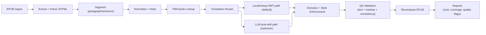

# EPUB English-to-French Translation System Architecture

## 1. Purpose
Build a cost-efficient system that translates EPUB books from English to French while preserving formatting and structure, and minimizing paid LLM token usage.

## Glossary
- DRM(Digital rights management): technology used to protect digital documents from direct access or modification.
- EPUB: standard file format used to store content such as book.
- LLM(Large Language Model): a program trained on a large amount of data and capable of generating content.
- TM(Translation Memory): A cache of already covered sentences, words our program would already translate.
- NMT(Neural Machine Translation): Specific machine learning type, exclusively used and trained for translation. ([more infos](https://blog.pangeanic.com/fr/quelle-est-la-meilleure-solution-pour-mon-cas-dutilisation-la-traduction-nmt-neuronale-ou-llm-notre-livre-blanc))

## 2. Scope
- Input: DRM-free `.epub` files in English.
- Output: translated `.epub` in French with valid packaging and preserved styling.
- Translation quality target: publishable draft quality for prose, with optional human post-edit.
- Cost target: keep average translation cost per book predictable and significantly lower than full-book LLM translation.

## 3. Non-Goals (V1)
- OCR for scanned PDFs.
- Real-time web app editor.
- Fully autonomous literary-quality translation with no human review.
- Translation of DRM-protected content.

## 4. Core Constraints

### 4.1 Cost Constraints
- Avoid sending full chapter content to premium LLMs.
- Maximize reuse via translation memory (TM) and caching.
- Prefer local or low-cost neural machine translation (NMT) for first pass.
- Escalate to LLM only for low-confidence or high-value segments.

### 4.2 Technical Constraints
- Preserve EPUB validity (`mimetype`, `META-INF/container.xml`, OPF/NCX/nav).
- Preserve inline markup (`<em>`, `<strong>`, links, ruby/footnotes where present).
- Keep paragraph and sentence alignment traceable for QA and re-runs.

### 4.3 Quality Constraints
- Consistent terminology for names, places, and lore.
- Stable tone/register in French across chapters and adapted to the story.
- No missing text, duplicated text, or broken tags after rebuild.

### 4.4 Legal and Policy Constraints
- Only process content the user has rights to translate.
- Respect provider API data-retention and usage policies.
- Protect uploaded content (encryption at rest/in transit if remote services are used).

## 5. High-Level Architecture

## 6. Component Design

### 6.1 Ingestion and EPUB Parser
Responsibilities:
- Unzip EPUB and load manifest/spine.
- Parse XHTML content in spine order.
- Extract translatable nodes while protecting non-translatable nodes (code blocks, references, metadata).

Recommended Go packages:
- `archive/zip` + `encoding/xml` (stdlib) for EPUB packaging and OPF/container parsing.
- `golang.org/x/net/html` for robust XHTML/HTML node parsing and traversal.
- Optional: `github.com/beevik/etree` for XML-heavy transformation flows.

Output artifact:
- Ordered list of translation units with IDs:
  - `book_id`, `chapter_id`, `node_path`, `source_text`, `context_prev`, `context_next`, `markup_tokens`.

### 6.2 Segmentation and Normalization
Responsibilities:
- Split text into sentence-aware chunks, then merge to target token budget.
- Normalize whitespace/quotes for stable hashing.
- Preserve placeholders for inline tags before translation.

Design rules:
- Target chunk size: ~80-350 words (configurable).
- Attach limited context window (previous/next sentence) when needed.
- Generate stable `segment_hash = sha256(normalized_source_text)`.

### 6.3 Translation Memory (TM) and Cache
Responsibilities:
- Reuse prior translations by exact hash match.
- Support optional fuzzy match for near-duplicates.

Storage:
- SQLite (V1) with optional PostgreSQL migration later.

Suggested tables:
- `segments(source_hash PK, source_text, target_text, source_lang, target_lang, engine, quality_score, created_at)`
- `glossary(term_en, term_fr, category, locked)`
- `runs(run_id, book_id, started_at, ended_at, total_segments, cache_hits, llm_calls, estimated_cost)`

### 6.4 Translation Router
Responsibilities:
- Route each segment to the cheapest acceptable path.

Routing policy (default):
1. Exact TM hit -> reuse.
2. Else local/cheap NMT translation.
3. Evaluate confidence/quality heuristics.
4. Escalate only flagged segments to LLM post-edit.

Escalation triggers examples:
- Very long or nested dialogue.
- Idiomatic phrases detected.
- High named-entity density with glossary conflicts.
- Heuristic low confidence from MT quality estimator.

### 6.5 LLM Post-Edit Service (Selective)
Responsibilities:
- Improve fluency and style while preserving meaning and placeholders.

Prompt constraints:
- Must preserve placeholder tokens exactly.
- Must follow glossary and style guide.
- Must return strict JSON output (`translated_text`, `notes`, `changed_terms`).

Operational guardrails:
- Rate limiting and budget caps per run.
- Hard stop when monthly budget threshold is reached.

### 6.6 Glossary and Style Enforcement
Responsibilities:
- Enforce canonical translation for proper nouns/terms.
- Apply consistent register (e.g., neutral modern literary French).

Implementation pattern:
- Pre-translation: annotate terms/placeholders.
- Post-translation: validate required term mappings.
- Reject or auto-correct violations based on lock level.

### 6.7 QA and Validation
Automated checks:
- Markup integrity: all placeholders restored, no tag loss.
- Coverage: no untranslated source fragments above threshold.
- Consistency: glossary compliance and repeated phrase consistency.
- Structural checks: chapter count, spine order, and nav integrity.

Optional checks:
- Back-translation sampling for semantic drift.
- Language detection for accidental English leftovers.

### 6.8 EPUB Recomposer
Responsibilities:
- Reinsert translated text into original XHTML nodes.
- Rebuild EPUB archive with correct ordering and metadata.
- Validate final EPUB with `epubcheck`.

## 7. Data Flow and Run Lifecycle
1. User submits EPUB + optional glossary/style config.
2. System parses and segments content.
3. TM/cache lookup resolves reusable segments.
4. Router sends unresolved segments to local/cheap MT.
5. Flagged subset goes to LLM post-edit.
6. QA pipeline validates text and structure.
7. System rebuilds EPUB and emits run report.

Run report fields:
- Total segments
- TM hit rate
- MT-only segment count
- LLM-escalated segment count
- Estimated and actual API cost
- QA warnings/errors

## 8. Cost Model and Budget Controls

### 8.1 Cost Levers
- Increase TM hit rate over time (largest long-term savings).
- Tune escalation threshold to limit LLM usage.
- Keep chunk size small enough to avoid unnecessary context tokens.
- Use batch API modes when available.

### 8.2 Budget Guardrails
- Per-book budget cap (hard stop).
- Daily and monthly spend caps.
- Max LLM-escalated segment percentage (e.g., 10-20% default).
- Abort run if projected cost exceeds configured cap.

## 9. Deployment Approach

### 9.1 V1 Local CLI (Recommended)
- Go CLI for single-machine runs.
- SQLite for TM.
- Local model runtime (or low-cost API) plus optional LLM API key.

Pros:
- Low complexity, high privacy, fast iteration.

### 9.2 V2 Service Mode
- Queue-based workers for multiple books.
- Central TM database.
- Observability, retries, and multi-user auth.

## 10. Reliability and Observability
- Structured logs with `run_id`, `chapter_id`, `segment_id`.
- Metrics:
  - `translation_segments_total`
  - `translation_cache_hit_ratio`
  - `translation_llm_escalation_ratio`
  - `translation_cost_usd_total`
  - `epub_validation_failures_total`
- Retry policy for transient API failures with idempotent segment processing.

## 11. Security
- Secrets via environment variables or secret manager.
- Encrypt persisted source/target content where feasible.
- Minimize retention of full original texts in logs.
- Redact sensitive metadata from debug outputs.

## 12. Testing Strategy
- Unit tests: segmentation, placeholder round-trip, glossary enforcement.
- Integration tests: full parse -> translate -> rebuild on fixture EPUBs.
- Regression tests: chapter-level snapshots for consistency.
- Cost tests: synthetic run to verify budget guardrails trigger correctly.

## 13. Phased Implementation Plan

### Phase 1: Core MVP
- EPUB parser + segmenter
- Local/cheap MT path
- EPUB rebuild + validation
- Basic CLI

Exit criteria:
- Produces valid translated EPUB end-to-end on sample novels.

### Phase 2: Cost Optimization
- TM/cache persistence
- Glossary support
- Run reporting

Exit criteria:
- Demonstrable cost reduction on repeated runs/books.

### Phase 3: Quality Optimization
- Selective LLM post-edit
- Confidence-based routing
- Advanced QA checks

Exit criteria:
- Improved quality with bounded cost increase.

### Phase 4: Production Hardening
- Worker queue
- Observability dashboards
- Failure recovery and resumable runs

Exit criteria:
- Stable multi-book throughput with predictable SLA and spend.

## 14. Key Risks and Mitigations
- Risk: Broken EPUB formatting after translation.
  - Mitigation: placeholder tokenization + strict structural QA + epubcheck gate.
- Risk: Cost spikes from over-escalation to LLM.
  - Mitigation: hard caps, routing thresholds, and pre-run cost projection.
- Risk: Inconsistent term translations.
  - Mitigation: locked glossary and consistency checks.
- Risk: Low literary quality in nuanced passages.
  - Mitigation: selective LLM post-edit and optional human review workflow.

## 15. Suggested Initial Tech Stack
- Language: Go
- Parsing: `archive/zip`, `encoding/xml`, `golang.org/x/net/html`
- Storage: SQLite (V1) via `modernc.org/sqlite` (pure Go) or `github.com/mattn/go-sqlite3` (CGO)
- CLI: `cobra` (optional)
- QA/validation: `epubcheck` integration
- Optional local MT runtime: Marian/NLLB-compatible pipeline exposed via local service

## 16. Definition of Done (Per Book Run)
- Valid EPUB generated and opens in common readers.
- No critical QA failures (tag loss, missing chapters, broken nav).
- Cost report generated with segment-level accounting.
- Glossary compliance above configured threshold.
