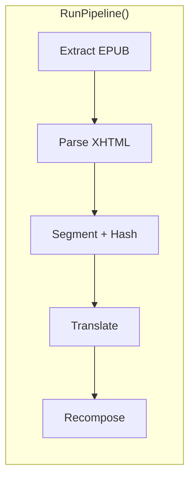
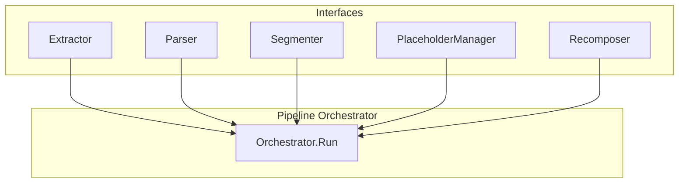
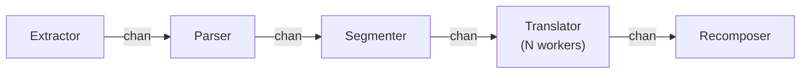

# RFC 0004: EPUB Parse/Segment/Recompose Pipeline

- Status: `proposed`
- Authors: ECecillo
- Created: 2026-03-08
- Updated: 2026-03-08
- Related:
  - Architecture: `docs/ARCHITECTURE.md`
  - Milestones: `docs/milestones/M1-core-mvp.md`
  - Implementation Plan: `docs/implementation/epub-pipeline.md`
  - Supersedes: n/a
  - Superseded by: n/a

## Context

The M1 Core MVP requires a complete EPUB translation pipeline that can:
1. Parse and extract content from DRM-free EPUB files
2. Segment text into translatable units at paragraph level
3. Preserve inline markup through placeholder tokenization
4. Recompose translated content back into valid EPUB format

This RFC defines the implementation approach for the `internal/epub`, `internal/segment`, and `internal/pipeline` packages.

## Goals

- Parse EPUB archives and extract XHTML content in spine order
- Implement paragraph-level segmentation with stable segment IDs
- Tokenize inline markup (`<em>`, `<strong>`, `<a>`, ruby tags) as placeholders
- Restore placeholders after translation with >= 99.5% success rate
- Recompose valid EPUB archives that pass `epubcheck`
- Provide a testable, extensible pipeline architecture

## Non-Goals

- Sentence-level segmentation (deferred to Phase 2)
- Fuzzy TM matching (V1 uses exact hash match only)
- LLM post-editing integration (Phase 3 feature)
- OCR or image-to-text extraction
- Complex layout-sensitive content (MathML, SVG text flow)
- Interactive EPUB features (scripts, forms, media overlays)

## Options Considered

### Option A: Monolithic Single-Pass Pipeline

All parsing, segmentation, translation, and recomposition logic in a single `RunPipeline()` function.



**Pros:**
- Simple mental model with linear flow
- Minimal interface overhead
- Fast to implement for V1

**Cons:**
- Hard to test individual stages in isolation
- Difficult to extend for Phase 2/3 features
- Cannot resume mid-pipeline on failure
- Tightly coupled logic makes refactoring risky

### Option B: Interface-Driven Multi-Stage Pipeline

Clear separation between pipeline stages with defined interfaces and dependency injection. Each stage is independently testable and replaceable.



**Pros:**
- Clean separation of concerns
- Each component testable in isolation with mock dependencies
- Clear extension points for Phase 2/3 (fuzzy TM, LLM post-edit)
- Follows Go idioms (small interfaces, dependency injection)
- Error handling is explicit per stage with typed `StageError`

**Cons:**
- More upfront design and boilerplate
- Data transfer objects (DTOs) require copying between stages
- Sequential execution in V1 (no parallelism)

### Option C: Channel-Based Concurrent Pipeline

Use Go channels to stream segments through pipeline stages with configurable parallelism. Each stage runs as a goroutine.



**Pros:**
- Parallel translation (significant speedup for HTTP NMT calls)
- Natural backpressure handling via channel buffers
- Idiomatic Go concurrency patterns
- Good fit for I/O-bound translation workload

**Cons:**
- Most complex to implement and debug
- Race condition risks require careful testing
- Out-of-order segment completion complicates recomposition
- Overkill for V1 if NMT is local/fast

## Proposed Decision

**Recommend Option B: Interface-Driven Multi-Stage Pipeline**

### Justification

1. **V1 Simplicity with Future-Proofing**
   - Handles paragraph-level segmentation, exact TM matching, and single NMT path cleanly
   - Interfaces make Phase 2/3 additions (fuzzy TM, LLM post-edit) straightforward without architectural changes

2. **Testability Aligns with Project Standards**
   - Existing code uses table-driven tests and fuzz tests (see `internal/cli/flags_test.go`)
   - Interface-based design enables mock injection for isolated unit tests
   - Each stage can be tested independently before integration

3. **Error Handling Consistency**
   - Project uses sentinel errors and `errors.Is` patterns (see `internal/cli/errors.go`)
   - `StageError` type fits this pattern, enabling clean exit code mapping
   - Exit codes already defined in `internal/exitcode/codes.go`

4. **Memory Profile Acceptable for V1**
   - Target is DRM-free prose EPUBs (novels, typically < 10MB uncompressed)
   - Loading full book into memory is acceptable for V1
   - Interface boundaries allow streaming implementation in V2 without breaking contracts

5. **Avoids Over-Engineering**
   - Option A is too rigid for documented Phase 2/3 requirements
   - Option C's concurrency complexity is not justified until NMT latency proves to be a bottleneck
   - Option B can evolve to Option C later by adding channel-based orchestration while keeping same interfaces

## Design

### Package Structure

```
internal/
├── epub/
│   ├── doc.go              # Package documentation
│   ├── errors.go           # Sentinel errors
│   ├── types.go            # Book, Manifest, SpineItem, XHTMLDocument, RawEPUB
│   ├── extractor.go        # Extractor interface + ZipExtractor
│   ├── parser.go           # Parser interface + OPFParser
│   ├── xhtml.go            # XHTML node parsing helpers
│   ├── recomposer.go       # Recomposer interface + EPUBRecomposer
│   └── *_test.go           # Unit tests
├── segment/
│   ├── doc.go              # Package documentation
│   ├── errors.go           # Sentinel errors
│   ├── types.go            # Segment, Placeholder, PlaceholderType, SegmentStatus
│   ├── segmenter.go        # Segmenter interface + ParagraphSegmenter
│   ├── normalizer.go       # Text normalization
│   ├── hasher.go           # SHA256 hash computation
│   ├── placeholder.go      # PlaceholderManager (tokenize/restore)
│   └── *_test.go           # Unit tests
├── pipeline/
│   ├── doc.go              # Package documentation
│   ├── errors.go           # StageError type
│   ├── types.go            # RunConfig, RunResult, Stage enum
│   ├── orchestrator.go     # Pipeline coordination
│   └── *_test.go           # Unit tests
```

### Key Interfaces

```go
// internal/epub/extractor.go
type Extractor interface {
    Extract(ctx context.Context, path string) (*RawEPUB, error)
}

// internal/epub/parser.go
type Parser interface {
    Parse(ctx context.Context, raw *RawEPUB) (*Book, error)
}

// internal/segment/segmenter.go
type Segmenter interface {
    Segment(ctx context.Context, doc *epub.XHTMLDocument, chapterID string) ([]Segment, error)
}

// internal/segment/placeholder.go
type PlaceholderManager interface {
    Tokenize(node *html.Node) (text string, placeholders []Placeholder, err error)
    Restore(translatedText string, placeholders []Placeholder, node *html.Node) error
}

// internal/epub/recomposer.go
type Recomposer interface {
    Recompose(ctx context.Context, book *Book, outputPath string) error
}
```

### Key Types

```go
// internal/epub/types.go
type RawEPUB struct {
    Mimetype   []byte
    Container  []byte              // META-INF/container.xml
    OPFPath    string
    OPFContent []byte
    Files      map[string][]byte   // All files by path
}

type Book struct {
    Path       string
    Manifest   Manifest
    Spine      []SpineItem
    Contents   map[string]*XHTMLDocument  // href -> parsed doc
    Resources  map[string][]byte          // Non-XHTML files
}

// internal/segment/types.go
type Segment struct {
    ID              string          // e.g., "ch_0001_p_0012"
    ChapterID       string
    NodePath        string          // XPath-like location
    SourceText      string
    NormalizedText  string
    Hash            string          // SHA256 of normalized
    Placeholders    []Placeholder
    TargetText      string
    Status          SegmentStatus
    Node            *html.Node      // Reference for recomposition
}

type Placeholder struct {
    ID       string  // e.g., "<x id=\"1\"/>"
    Original string  // Original markup
    Type     PlaceholderType
}
```

### Pipeline Orchestrator

```go
// internal/pipeline/orchestrator.go
type Orchestrator struct {
    Extractor   epub.Extractor
    Parser      epub.Parser
    Segmenter   segment.Segmenter
    TMStore     TMStore     // Interface from internal/tm
    Translator  Translator  // Interface from internal/translate
    Recomposer  epub.Recomposer
    Logger      *zap.Logger
}

func (o *Orchestrator) Run(ctx context.Context, cfg RunConfig) (*RunResult, error) {
    // Stage 1: Extract
    // Stage 2: Parse
    // Stage 3: Segment all spine documents
    // Stage 4: TM Lookup + Translate
    // Stage 5: Recompose
}
```

### Error Handling

```go
// internal/pipeline/errors.go
type Stage string

const (
    StageExtract   Stage = "extract"
    StageParse     Stage = "parse"
    StageSegment   Stage = "segment"
    StageTMLookup  Stage = "tm_lookup"
    StageTranslate Stage = "translate"
    StageRecompose Stage = "recompose"
)

type StageError struct {
    Stage Stage
    Err   error
}

func (e *StageError) Error() string {
    return fmt.Sprintf("pipeline stage %s failed: %v", e.Stage, e.Err)
}

func (e *StageError) Unwrap() error {
    return e.Err
}
```

## Implementation Plan

See `docs/implementation/epub-pipeline.md` for the detailed TDD-driven implementation plan with:
- 6 development phases
- TDD workflow tables (RED-GREEN-REFACTOR)
- Files to create in order
- Acceptance criteria per phase

## Impact

### Technical
- New packages: `internal/epub`, `internal/segment`, `internal/pipeline`
- Dependency added: `golang.org/x/net/html`
- Integration point: `internal/commandexec/execute.go`

### Cost
- No runtime cost impact (local processing)
- Development cost: ~4-6 dev phases

### Security/Compliance
- Only processes local files from `--input` flag
- No external data transmission in parsing/segmentation
- Translation data sent only to configured NMT endpoint

## Acceptance Criteria

- [ ] `epubcheck` passes for all fixture outputs
- [ ] Placeholder restoration ratio >= 99.5%
- [ ] Missing spine documents = 0
- [ ] All unit tests pass with >= 80% coverage
- [ ] All integration tests pass
- [ ] `just check` passes (fmt + lint + test)

## Risks and Mitigations

| Risk | Mitigation |
|------|------------|
| Broken EPUB formatting after translation | Placeholder tokenization + strict structural QA + epubcheck gate |
| Placeholder restoration failures | Fuzz testing for tokenize/restore round-trip, explicit error on mismatch |
| XHTML edge cases (malformed markup) | Use `golang.org/x/net/html` which handles malformed HTML gracefully |
| Large EPUB memory pressure | V1 accepts this; interfaces allow streaming implementation in V2 |
| Complex nested inline markup | Define clear precedence rules, test with edge-case fixtures |

## Open Questions

- Should placeholder IDs be globally unique across the book or per-chapter?
- What is the exact XPath format for `node_path` (full path vs. simplified)?

## Decision Log

- 2026-03-08: Status set to `proposed` (initial proposal).
- 2026-06-14: Option B implemented across `internal/{epub,segment,tm,translate,qa,glossary,pipeline}` and wired into the `run` command with integration tests on 3 fixtures. Recomposer signature evolved to `Recompose(ctx, raw *RawEPUB, book *Book, outputPath)` so it has both the original archive bytes and the mutated content docs. Placeholder strategy: inline child elements are opaque `<x id="N"/>` tokens (deterministic restoration, guaranteed valid markup). Open question resolved: placeholder IDs are per-segment.
