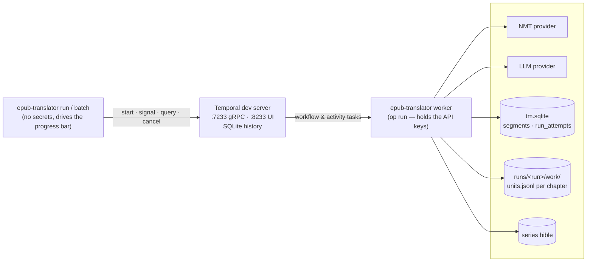
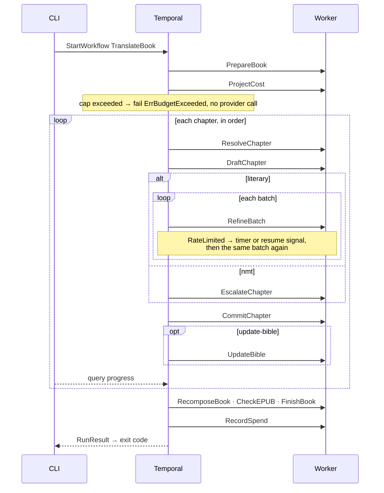
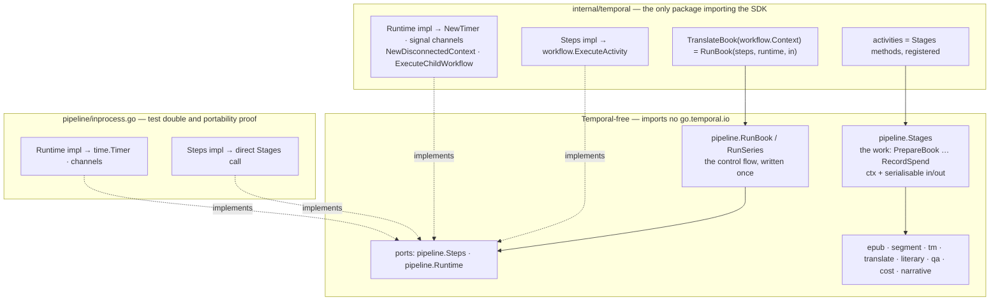

# RFC 0009: Temporal as the Execution Engine of the Translation Pipeline

- Status: `proposed`
- Authors: ECecillo
- Created: 2026-09-10
- Updated: 2026-09-10
- Related:
  - Architecture: `docs/ARCHITECTURE.md` (§5, §7, §9.2, §10)
  - Milestones: `docs/milestones/M4-production-hardening.md` (replaces items 1 and 5 of its plan)
  - Illustrated companion: `docs/architecture-temporal.html`
  - Builds on: [0004 - EPUB Pipeline](./0004-epub-pipeline.md), [0007 - Token-Based Budget Guardrail](./0007-google-translate-draft-and-token-cost-model.md)
  - Does not require: [0005 - TM Storage Evolution](./0005-tm-storage-evolution.md) (SQLite stays)
  - Supersedes: n/a
  - Superseded by: n/a

## Context

A run today is one in-process function. `Orchestrator.Run`
(`internal/pipeline/orchestrator.go:81-281`) walks extract → parse → segment →
project → translate → recompose → QA → artifacts while holding every piece of
state in memory: the `RunResult` counters, the NMT meter baseline (`sentBefore`,
line 196), the `costFn` closure (202-206), the `OnBatch` hook that both meters
tokens and repaints the progress bar (`mode.go:218-226`), and a deferred ledger
write that must survive a cancelled context (217-220, 313-348).

Reliability is hand-rolled around it, one mechanism per failure mode:

- transient NMT failures: `RetryingTranslator` (`internal/translate/retry.go`),
  three attempts, linear backoff;
- a bad LLM batch: degrade to the draft (`literary/translator.go:187-192`);
- quota exhaustion: `llm.ErrRateLimited` is the one non-degradable batch failure
  (`translator.go:194-197`) — it fails the run, and the operator re-launches;
- resuming: the translation memory. A re-launch re-extracts, re-segments and
  re-projects the whole book, then pays only for the segments the TM lacks. The
  resume boundary is the chapter (journal, session 18): a 429 on batch 3 of 4
  throws away batches 1 and 2.

Measured on the real workload (vol33: 45 chapters, 4,774 segments, 101 LLM
calls, ~27 $, several hours on a provider whose quota is a 5-hour window), that
is the operational shape of the tool: a long, multi-stage, externally
rate-limited job that must never pay twice and that a human occasionally has to
approve or resume.

M4 already planned to build what that shape needs — "queue contract and worker
runtime", "distributed idempotency and retry controls", "failure recovery and
resumable runs at scale" (`M4-production-hardening.md:19-27, 29-38`). That is a
workflow engine, written by hand, in a one-person project.

## Goals

- A run survives worker death, provider outages and quota exhaustion without
  redoing paid work and without the operator re-launching it.
- Resume granularity becomes the **LLM batch**, not the chapter or the run.
- Run state is observable outside the process (Temporal UI) and in the CLI.
- A series of N volumes is one durable, ordered execution.
- Stage packages (`epub`, `segment`, `tm`, `translate`, `literary`, `qa`,
  `cost`, `narrative`) stay Temporal-agnostic. `estimate` keeps working with no
  server running.
- One engine at the end. No permanent dual maintenance of an in-process path
  and a Temporal path.

## Non-Goals

- Multi-tenant service, HTTP API, auth (M4 out of scope stays out of scope).
- PostgreSQL migration (RFC 0005). SQLite stays; this RFC sizes concurrency for it.
- Parallel chapter translation. Literary order (`prevCtx`, bible) and SQLite's
  single writer both forbid it; revisit after RFC 0005.
- Temporal Cloud. Local dev server only.

## Options Considered

### Option A: Status quo, deeper checkpointing
Persist per-batch translations in a run-scoped store, sleep-and-retry on 429,
re-launch from the last checkpoint.
- Pros: no infrastructure, no dependency, incremental.
- Cons: durable timers, retry policy, run state machine, pause/resume and
  visibility all become bespoke code — M4's plan, item by item. Each is a
  well-known problem with a boring solution elsewhere.

### Option B: Job queue (River on PostgreSQL, Asynq on Redis)
Chapters or batches become jobs with retries.
- Pros: simpler mental model than Temporal; retries and dead-letter for free.
- Cons: a job is not a workflow. Ordering across chapters, the pause on 429, the
  spend accumulation, the "finish and record spend on failure" cleanup, and the
  series-of-books orchestration all have to be encoded as job state by hand. It
  also brings PostgreSQL or Redis in, which this RFC does not otherwise need.

### Option C: Temporal (self-hosted dev server, Go SDK)
The run becomes a Workflow; each stage an Activity with its own timeout and
retry policy; 429 becomes a timer or a signal; progress a query; a series a
parent workflow of child workflows.
- Pros: durable execution with replay, per-activity retries, timers, signals,
  queries, child workflows, a UI, and a replay-based test harness — every item
  of M4's plan 1 and 5, maintained by someone else. Go is a first-class SDK.
- Cons: an always-on server for `run` (one container); a heavy dependency tree
  (`go.temporal.io/sdk` → gRPC, protobuf); workflow code must be deterministic;
  payload and history limits (2 MB per payload, warning at 256 KB; 51,200
  events / 50 MB per run) forbid passing the book or the node tree around —
  which the current design does.

## Proposed Decision

Option C, under six conditions that keep the blast radius small:

1. **Activities are the existing stage functions.** No business rule lives in
   Temporal code. The workflow function is one line: `pipeline.RunBook(steps, runtime, in)`.
2. **The flow is engine-agnostic too.** Control flow, accounting, pause and
   cleanup live in `pipeline.RunBook`, written against two small ports
   (`Steps`, `Runtime`). `internal/temporal` is the only package importing the
   SDK, enforced by `depguard`. Leaving Temporal means rewriting that package.
3. **One shipped engine at the end.** Phase 6 deletes `RetryingTranslator`,
   `OnBatch`, `costFn`, the in-pipeline progress hooks and the CLI's in-process
   path. The in-process `Steps`/`Runtime` pair stays as the flow's test double
   and portability proof. `pipeline.Plan` stays, for `estimate`.
4. **References cross Temporal, not content.** Payloads carry run/chapter
   references, segment IDs, counters and a ~1,200-rune context tail. The EPUB
   bytes and the `*html.Node` trees never do.
5. **Local-first.** `temporal server start-dev --db-filename` (SQLite) in
   `docker-compose.yml`, UI on 8233. No PostgreSQL service.
6. **One worker, one activity slot** on the task queue that writes the TM,
   until RFC 0005 lands.

The precondition the current code does not meet is condition 4.
`segment.Segment.Node` (`internal/segment/types.go:68`) and
`Placeholder.node` (line 50) are live pointers into a tree that `Restore`
mutates and `Recompose` renders (`internal/epub/recomposer.go:37-61`). Phase 1
removes that coupling **without Temporal**, and is worth shipping on its own:
segmentation is deterministic (IDs by position, hash by normalized text), so a
process that holds only `{segment_id, target_text}` can re-parse the original
document, re-derive the placeholders, restore, validate and render. That is
exactly what `segments.jsonl` (`ARCHITECTURE.md §16.1`) already claims to be.

## Design

### Topology



### Workflows

| Workflow | Input | Output | Notes |
|---|---|---|---|
| `TranslateBook` | `BookInput{RunID, BookID, InputPath, OutputDir, Mode, SeriesID, SourceLang, TargetLang, UpdateBible}` | `RunResult` (schema 16.3, unchanged) | One per volume. Sequential over chapters. |
| `TranslateSeries` | `SeriesInput{Books []BookInput, ReferenceDir}` | `BatchSummary` | Parent of `TranslateBook` children, in order, continue-on-failure as `batch` does today. |

Workflow state is the `RunResult` accumulator. Every activity returns what it
consumed (chars, tokens, attempts, hits) and the workflow sums it. That replaces
the meter delta and the `OnBatch` hook, and the history becomes the audit trail
the ledger used to be the only copy of.

### Activities

All activities hang off one `Activities` struct holding the injected
collaborators the orchestrator holds today (`orchestrator.go:43-72`). Inputs
and outputs are small, JSON-serialisable structs.

| Activity | In → Out | What it wraps |
|---|---|---|
| `PrepareBook` | `BookInput` → `Manifest{Chapters []{ID, Href, Segments, Chars}}` | extract + parse + segment; writes `work/<chapter>.jsonl` (units, schema 16.1) |
| `ProjectCost` | `{RunRef, Mode}` → `Projection{EnforcedUSD, NoReuseUSD, Pending, Reusable, UsedFreeChars, Windows}` | `pendingChapters`, `freeCharsUsed`, `checkRollingBudgets`, `mode.Project` |
| `ResolveChapter` | `{RunRef, ChapterID, ReusesDrafts}` → `{Reused int, Fresh []SegmentID}` | `lookupTranslation` / TM part of `resolveTranslation`; writes reused targets to the unit file |
| `DraftChapter` | `{RunRef, ChapterID, Fresh, PersistDrafts}` → `{Chars, Engine}` | `draftSegments` (glossary protect/apply, one batched NMT call); persists drafts only in NMT mode |
| `EscalateChapter` | `{RunRef, ChapterID, Fresh}` → `{Attempts, Chars, Improved, QESum, QECount}` | NMT-mode QE + `SafePostEdit` loop (`orchestrator.go:627-676`) |
| `RefineBatch` | `{RunRef, ChapterID, IDs, PrevTail}` → `{Usage, Refined, Degraded []string, Tail}` | one literary LLM batch, halving-on-truncation included; heartbeats between sub-calls |
| `CommitChapter` | `{RunRef, ChapterID, Persist}` → `{GlossaryViolations, RestoreFailures}` | re-derive placeholders, `Restore` as validation, persist to TM **only after** Restore accepted (`mode.go:344-368`), write final units |
| `UpdateBible` | `{SeriesID, ChapterID, RunRef}` → `{Version}` | `updateBible` with its `SaveIfVersion` loop |
| `RecomposeBook` | `{RunRef}` → `{OutputEPUB}` | `epub.ApplyTranslations` + `Recompose` |
| `CheckEPUB` | `{OutputEPUB}` → `{Passed, Skipped}` | `qa.EPUBChecker` |
| `FinishBook` | `{RunRef, RunResult}` → `qa.Report` | `qa.Evaluate` + `WriteArtifacts` |
| `RecordSpend` | `RunSpend + IdempotencyKey` | `TM.RecordRun`, made idempotent on the Temporal `(WorkflowID, RunID)` |
| `PriceRun` (local activity) | `{RunResult, UsedFreeChars, Mode}` → `USD` | `mode.Cost`; local because it is pure arithmetic over the cost model |

`RefineBatch` is per batch rather than per chapter on purpose: it is the
retry and resume unit. A worker killed after batch 2 of 4 restarts at batch 3.
The recursive halving that exists inside `TranslateChapter` today stays inside
the activity — sub-batches are the same logical unit and share its usage.

### The book workflow



Failure and cancellation paths run `FinishBook` and `RecordSpend` under a
disconnected context (`workflow.NewDisconnectedContext`), which is the Temporal
form of today's deferred ledger write.

### Rate limit

`RefineBatch` (and `DraftChapter` for a paid NMT provider) surface
`llm.ErrRateLimited` as a **non-retryable** application error of type
`RateLimited`. The workflow — not the activity retry policy — handles it:

1. state ← `paused(rate_limit)`, visible in the UI and the `progress` query;
2. wait on whichever fires first: a timer (30 min, doubling per consecutive
   wait, ceiling 5 h) or a `resume` signal;
3. re-execute the **same** batch. Bounded by a maximum number of waits, after
   which the run fails as it does today.

The completion cache (`llm_cache.sqlite`, keyed by model + messages) makes a
replayed call that had already succeeded free, so an activity that timed out
*after* the provider answered is not paid twice.

### Signals and queries

| Kind | Name | Effect |
|---|---|---|
| Signal | `pause` / `resume` | Stop before the next activity / continue. `resume` also ends a rate-limit wait early. |
| Query | `progress` | `{State, Stage, Chapter, Chapters, Segments, SegmentsDone, TMHits, CostUSD}` — polled by the CLI at ~500 ms to drive the existing bar. |
| Cancel | `CancelWorkflow` | Bound to SIGINT in the CLI; runs the cleanup path above. |

The bar is fed by Temporal, not by the pipeline. The workflow keeps a
`Progress` struct it updates from each activity's result and serves through
`workflow.SetQueryHandler("progress", …)`; the CLI calls `QueryWorkflow` on a
~500 ms ticker and forwards the values to `internal/progress`, which does not
change. A query is read-only and leaves no history event.

Granularity follows activity boundaries: the bar moves when an activity
completes. In literary mode that is the batch — the same cadence `OnBatch` gives
today. In NMT mode with escalation, `EscalateChapter` is one activity, so the bar
would hold for a whole chapter; if that matters, the escalation is split per
batch like the refinement is. It is a choice of activity size, not of design.

### Policies

| Activity | StartToClose | Heartbeat | Attempts, backoff | Non-retryable |
|---|---|---|---|---|
| `PrepareBook` | 5 m | — | 3 | `epub.Err*` (a bad archive does not get better) |
| `ProjectCost`, `ResolveChapter`, `CommitChapter`, `PriceRun` | 2 m | — | 3 | — |
| `DraftChapter` | 10 m | 30 s | 3, 1 s → 30 s ×2 | `RateLimited` (→ pause), non-429 4xx |
| `RefineBatch` | 15 m | 60 s | 3, 5 s → 2 m ×2 | `RateLimited` (→ pause), refusal (→ degrade, returned not raised) |
| `EscalateChapter` | 30 m | 60 s | 3 | — |
| `UpdateBible` | 10 m | 60 s | 3 | `narrative.ErrInvalidBible` |
| `RecomposeBook`, `CheckEPUB` | 10 m | — | 2 | — |
| `FinishBook`, `RecordSpend` | 1 m | — | 5 | — |

No workflow execution timeout: a paused run is a legitimate state. Worker:
`MaxConcurrentActivityExecutionSize = 1` (condition 6).

### Determinism and versioning

Workflow code uses `workflow.Now`, `workflow.GetLogger`, `workflow.SideEffect`
for anything non-deterministic, no goroutines, no map iteration that affects
decisions. Policy for in-flight runs: do not upgrade the worker mid-book; if a
change to `TranslateBook` must ship while a run is paused, gate it with
`workflow.GetVersion`. A replay test over a recorded history of the fixture
book runs in CI and fails on an accidental non-deterministic change.

### Idempotency

Activities can execute more than once (timeout after success, worker death).

- `TM.Save` is an upsert on `source_hash` — idempotent already.
- `RecordRun` appends one row per attempt on purpose (`ARCHITECTURE.md §16.4`).
  A retried *activity* is not a new attempt: the row gains an `attempt_key`
  (Temporal `WorkflowID/RunID`) with a unique index, `INSERT OR IGNORE`.
- `WriteArtifacts` overwrites — idempotent.
- A retried `DraftChapter` re-pays the NMT characters. Accepted; that is the
  contract `RetryingTranslator` has today (`retry.go:43-45`).
- A retried `RefineBatch` is served by the completion cache when the previous
  attempt got an answer.

### Payload and history budget

For vol33: manifest ≈ 45 × 100 B; a chapter plan ≈ 100 IDs × 20 B ≈ 2 KB; a
`RefineBatch` input is IDs plus a 1,200-rune tail ≈ 3 KB; every result is
counters. All two orders of magnitude under the 256 KB warning. History: per
chapter ≈ 3 fixed activities + ~2.3 batches, ≈ 5 events each → ≈ 30 events per
chapter, ≈ 1,400 per book, ≈ 7 % of the soft limit. A 30-book series is 30
child histories, not one. No `ContinueAsNew` needed.

### Code layout and coupling

Portability is a stated goal: the code must be movable to another engine (or
back to none) by rewriting one package. The layout is ports-and-adapters with
the whole business — stages **and** control flow — on the Temporal-free side.



Two ports, both small:

```go
// Steps is what the control flow can ask for. One method per activity, no
// context: the adapter owns it (workflow.Context is not a context.Context).
type Steps interface {
    PrepareBook(BookInput) (Manifest, error)
    ProjectCost(ProjectInput) (Projection, error)
    ResolveChapter(ResolveInput) (ChapterPlan, error)
    DraftChapter(DraftInput) (DraftResult, error)
    EscalateChapter(EscalateInput) (EscalateResult, error)
    RefineBatch(RefineInput) (RefineResult, error)
    CommitChapter(CommitInput) (CommitResult, error)
    UpdateBible(BibleInput) (BibleResult, error)
    RecomposeBook(RunRef) (RecomposeResult, error)
    CheckEPUB(CheckInput) (CheckResult, error)
    FinishBook(FinishInput) (qa.Report, error)
    RecordSpend(SpendInput) error
    PriceRun(PriceInput) (float64, error)
}

// Runtime is what the control flow needs from an engine, and nothing more.
type Runtime interface {
    Now() time.Time
    // WaitResume blocks for d or until a resume signal, whichever first.
    WaitResume(d time.Duration) (resumed bool, err error)
    Paused() bool                    // a pause signal is pending
    Cancelled() bool
    Detached() Runtime               // for cleanup after cancellation
    Report(Progress)                 // the flow publishes; in-process drives the bar, Temporal serves the query
    RunBook(BookInput) (RunResult, error) // series only: one child per volume
}
```

`Stages` is the concrete struct holding today's collaborators
(`orchestrator.go:43-72`); its methods take a real `context.Context` and are the
activity bodies. `RunBook` accumulates `RunResult`, publishes a `Progress`
snapshot through `rt.Report` at every step the bar used to advance on (the
adapter keeps the last one for the query), and follows the determinism
rules (`rt.Now()`, no goroutines, no decision on map order) — which is what lets
the same function run inside a Temporal workflow and inside a plain test.

What the adapter does **not** abstract: Temporal's own concerns — payload
codecs, task queues, worker options, `GetVersion`, replay tests. They live in
`internal/temporal` and go away with it.

The tradeoff, stated: the ports are a fixed vocabulary. A Temporal feature the
flow wants (an Update, a Nexus call) needs a port method first. For a 13-step
sequential pipeline that is the right price; the alternative — writing the flow
in `workflow.*` calls — is ~300 lines that would be rewritten on any engine
change, together with every test that exercises them.

```
internal/
  pipeline/                       Temporal-free
    types.go        BookInput · Manifest · ChapterPlan · Projection · RunResult · Progress
    stages.go       Stages struct + methods (the activity bodies)
    ports.go        Steps · Runtime
    book.go         RunBook — the flow (replaces Orchestrator.Run + mode.go loops)
    series.go       RunSeries
    inprocess.go    in-process Steps + Runtime (tests; portability proof)
    workspace.go    units.jsonl per chapter
    plan.go         Plan, for estimate (unchanged)
    artifacts.go · errors.go · doc.go
  epub/             ApplyTranslations(book, units) — new
  temporal/                       the adapter, only SDK importer
    client.go       Dial from config
    worker.go       registers TranslateBook, TranslateSeries, Stages methods
    workflow.go     TranslateBook / TranslateSeries glue, progress query, signals
    steps.go        Steps → ExecuteActivity with per-step options
    runtime.go      Runtime → timers, signal channels, disconnected ctx, child workflows
    policy.go       timeouts and retry per step
    errors.go       StageError ↔ ApplicationError type
    doc.go
  commandexec/      worker.go · run/batch start a workflow and follow it · estimate → pipeline.Plan
  config/           TemporalAddress · TemporalNamespace · TemporalTaskQueue
```

The import rule is enforced, not hoped for: a `depguard` rule in
`.golangci.yml` denies `go.temporal.io/**` everywhere except `internal/temporal`
and `internal/commandexec`. `golangci-lint` already gates every commit.

- New subcommand `worker`. It is the process wrapped in `op run`; `run` and
  `batch` no longer need a credential — which also retires the pipe-vs-tty
  detection of session 19, since the bar now lives in an unwrapped process.
- `run` keeps its flags and blocks until the workflow ends; exit codes map from
  the `ApplicationError` type (`extract`, `parse`, `segment`, `translate`, `qa`,
  `recompose`) to `internal/exitcode` unchanged.
- `just up` starts `temporal` + `worker`; `just run` starts a workflow.
- `estimate` calls `pipeline.Plan` directly, as today.

### Extension: adding a translation mode

A mode is a recipe over the existing `Steps`, never a new workflow. `RunBook`
selects a `Mode` from `BookInput.Mode`, which the workflow forwards without
reading:

```go
type Mode interface {
    ReusesDrafts() bool
    Project(pending []ChapterInfo, usedFreeChars int) cost.Projection
    Cost(result *RunResult, usedFreeChars int) float64
    Chapter(f *flow, ch ChapterInfo) error   // the per-chapter recipe, composed of Steps calls
}
```

`nmtMode.Chapter` = Resolve → Draft → Escalate → Commit. `literaryMode.Chapter` =
Resolve → Draft → RefineBatch × n → Commit (→ UpdateBible). An LLM-only mode,
the example asked for, is Resolve → RefineBatch × n (no draft) → Commit:

| Layer | Change | Size | Touches the adapter |
|---|---|---|---|
| `literary` | prompt variant without a draft (`DraftText` optional, `RefineInput.HasDraft`) | ~40 lines + decode tests | no |
| `pipeline` | `llmMode` struct; `Project` reuses the existing `full-llm` scenario (`cost/estimate.go:296`) | ~100 lines + `RunBook` scenarios | no |
| `internal/temporal` | nothing — no new activity, `RefineBatch` accepts an empty draft | 0 | — |
| `cli` | `--mode llm` accepted | ~10 lines | no |
| docs | `utilisation.html` §6, `comprendre-le-projet.html` §1 and recipe 3 | — | — |

A mode that needs a **new** step costs, in the adapter, one `Steps` method, one
`Stages` method, one activity registration and one `policy.go` line — ~30
mechanical lines; `depguard` flags anything more.

The real cost of an LLM-only mode is not code: the placeholder safety net falls
back on the NMT draft today, and without a draft it would fall back on the
English source. Either retry the degraded segment alone, or request a draft
on demand for the degraded ids (`DraftChapter` on a subset — the step exists).
To decide when that mode is built; `untranslated_segments` in QA catches the
failure either way.

## Implementation Plan

Each phase is one PR, green on `just check`, and leaves the tool usable.

1. **Decouple the stages from the process** (no Temporal, no new dependency).
   `epub.ApplyTranslations`; `pipeline/workspace.go` writing and reading per-chapter
   unit files; `Orchestrator.Run` and `mode.go` refactored into `pipeline.Stages`
   methods with serialisable inputs and outputs; the `Steps` and `Runtime`
   ports; `RunBook` as the flow over them; the in-process `Steps`/`Runtime`
   pair, which is what the CLI runs on until phase 6. Acceptance:
   `translated.epub` and `report.json` byte-identical on the fixture book before
   and after; vol33 chapter 97 (all TM hits) identical; `orchestrator_test.go`
   scenarios re-expressed as `RunBook` tests on the in-process runtime.
2. **Infrastructure.** `temporal` service in `docker-compose.yml`
   (`temporalio/temporal server start-dev --ip 0.0.0.0 --db-filename
   /data/temporal.db`, ports 7233 and 8233, pinned tag); `just temporal-up /
   temporal-down` folded into `up` / `down`; `preflight` probes 7233; the three
   `EPUB_TRANSLATOR_TEMPORAL_*` variables; `DEPENDENCIES.md` entry for
   `go.temporal.io/sdk`.
3. **Worker and the NMT workflow.** `internal/temporal` (client, worker,
   `Steps`/`Runtime` adapters, policy, error mapping), `worker` subcommand,
   `run --mode nmt` through Temporal; `progress` query wired to the bar; SIGINT
   → cancel → cleanup; ledger `attempt_key`; `depguard` rule. Tests: adapter
   wiring with `testsuite`, first recorded history for the replay test, one
   integration test against the dev server that skips when 7233 is unreachable
   (the `ollamaHost` pattern).
4. **Literary mode and the rate-limit pause.** `RefineBatch` per batch,
   `pause`/`resume`, cooldown timer, `UpdateBible`. The missing test of session
   18 becomes a `RunBook` test on the in-process runtime: fake `RefineBatch`
   returns `RateLimited` on the third call → state `paused` → `resume` →
   completes, and the number of paid calls equals a clean run's.
5. **Series.** `TranslateSeries` with sequential children; `batch` command
   through it; `batch-report.json` assembled from child results.
6. **Cutover and documentation.** Delete the in-process engine as the CLI's
   default (`pipeline/inprocess.go` stays, test-only), `RetryingTranslator`,
   `OnBatch`, `costFn`, the pipeline progress hooks and the
   tty probe. Update `ARCHITECTURE.md` §5, §7, §9, §10, §13; rewrite M4 around
   what Temporal now provides; `utilisation.html` (§4 services, §6 `worker`, §8
   variables, §11 recipes), `comprendre-le-projet.html` (§1 widget, §11 map,
   §13 invariants); README; `just docs-audit`.

## Testing Strategy

Five levels, fastest first. The first four need no server and run in
`just check`; the fifth starts the dev server as a CI service container (it
boots in ~2 s) and skips locally when 7233 is unreachable — the `ollamaHost`
pattern. **The Temporal SDK test API is used only at level 3**, on the one
package that imports the SDK.

1. **Stages** — the existing package tests of `epub`, `segment`, `tm`,
   `literary`, `qa`, `cost`. Unchanged: business logic does not move packages,
   activities are wrappers.
2. **Flow** — `pipeline.RunBook` / `RunSeries` on the in-process `Runtime` with
   a fake `Steps` (a struct of func fields recording calls and returning
   scripted results). Plain Go, no SDK. This is where control flow,
   accumulation, pause, resume, cancel and error mapping are proven — the
   scenarios of `orchestrator_test.go` land here in phase 1.
3. **Adapter** — `internal/temporal` with `testsuite.WorkflowTestSuite`,
   `TestActivityEnvironment`: activity options per step, timer ↔ `WaitResume`,
   signal channel ↔ `Paused`/`resume`, `StageError` ↔ `ApplicationError`
   type, the `progress` query. Wiring only, no business scenario.
4. **Replay** — `worker.NewWorkflowReplayer` over a recorded history of the
   fixture book in `internal/temporal/testdata`. Fails on non-determinism —
   including in `RunBook`, since it executes inside the workflow.
5. **Integration** — `tests/integration` against the dev server, with
   `nmt-devserver` and `llmtest` as providers.

Per phase:

| Phase | Proves | How | Existing tests |
|---|---|---|---|
| 1 | Re-deriving placeholders from `{id, target}` renders the same book as in-place mutation; the flow behaves as `Run` did | `epub.ApplyTranslations` table-driven: identity round trip (source applied as target → identical bytes), unknown id → sentinel, missing placeholder → segment left as source. `workspace` round trip, corrupt line → error. Level 2: `RunBook` scenarios ported from `orchestrator_test.go` (nominal sums, cap refused with no `DraftChapter` call, cancel → `FinishBook` + `RecordSpend`, stage error → exit code). Golden sha256 of the fixture's `translated.epub` and `report.json`, frozen **before** the refactor | `orchestrator_test.go` scenarios move to `book_test.go`; the file is deleted with `Run` |
| 2 | The service starts and the CLI sees it | `preflight` probe reachable / unreachable; manual smoke `just up` → UI; `docs-audit` for the variables | — |
| 3 | The adapter dispatches, maps and serves what the flow expects | Level 3: each `Steps` method reaches the activity of the same name with its options; `WaitResume` returns on timer and on signal; error type mapping both ways; query returns `Progress()`. Level 4: first recorded history. Level 5: fixture end to end; *worker kill* = cancel the first worker's context mid-run, start a second, assert completion and that `nmt-devserver`'s request count equals a clean run's. Payload test: every serialised input/output < 256 KB. `depguard` forbids the SDK outside the adapter | none removed; `RetryingTranslator` stays tested until phase 6 |
| 4 | A 429 pauses, resumes **the same batch**, and does not bill the batches that succeeded | Level 2: fake `RefineBatch` returns `RateLimited` on the 3rd call then succeeds; in-process `WaitResume` fed by a test channel; asserts `paused` in `Progress()`, calls = clean run + 1, tokens = clean run. Max waits → failure. `pause`/`resume` outside a 429. Level 5: `llmtest` answers 429 on the Nth call — the integration test session 18 left missing | `literary/translator_test.go` unchanged: batch splitting stays in the package |
| 5 | Volumes run in order; one failure does not stop the series | Level 2: `RunSeries` with a fake `Runtime.RunBook`: start order; one child fails → parent continues, summary counts it. Level 3: `RunBook` port → `ExecuteChildWorkflow` | — |
| 6 | Nothing the deleted code proved goes unproven | `retry_test.go` goes with `RetryingTranslator`; `Plan` and its tests stay for `estimate`; `inprocess.go` stays as the level-2 runtime | deleted with the code they covered, never re-pinned to the new text |

## Rollout Plan

- One environment: the developer's machine. Phases 1–2 change nothing a user sees.
- Phases 3–5 add the Temporal path while the in-process path stays the default;
  `EPUB_TRANSLATOR_ENGINE=temporal` selects the new one during that window and
  is removed in phase 6.
- Rollback: before phase 6, unset the variable; after phase 6, revert the phase 6 PR.

## Impact

### Technical
- Reliability: retries, timers, resume and cleanup move from six bespoke
  mechanisms to one engine with a UI.
- Maintainability: less code in `pipeline` (the loops and hooks go), more in
  `workflow` (declarative control flow). The stage packages do not change shape.
- Testability: the "429 in the middle of a volume" scenario becomes a unit test.
- Cost of complexity: determinism discipline in one package; a server to run.

### Cost
- Infrastructure: one extra container, SQLite-backed, zero external cost.
- Provider: unchanged in the nominal case; strictly lower after failures,
  because a batch is never paid twice and a 429 no longer discards a chapter.

### Security/Compliance
- Secrets move to the worker process only. Payloads carry no book text beyond
  a 1,200-rune context tail, and the dev server's SQLite file lives under
  `data/` next to the TM and the bible, with the same handling.

## Acceptance Criteria

- `kill -9` the worker mid-chapter, restart it: the run completes, and the
  ledger's LLM call count equals a clean run's (no batch paid twice).
- A 429 injected on batch k: the run shows `paused` in UI and CLI; a `resume`
  signal completes it; no re-extraction, no re-projection appears in history.
- vol33 end to end through Temporal: same QA gate verdict, `report.json`
  schema unchanged, `actual_cost_usd` within 1 % of the in-process run.
- Largest payload on vol33 < 256 KB; history < 10,240 events per book.
- `estimate` succeeds with the Temporal container stopped.
- `go.mod` gains `go.temporal.io/sdk` and its transitive closure, nothing else.

## Risks and Mitigations

- Risk: non-deterministic workflow code found only in production.
  - Mitigation: replay test in CI; workflow package reviewed against the
    determinism rules; no I/O outside activities.
- Risk: dependency weight and version drift between SDK and server.
  - Mitigation: pin both; the compose image tag and `go.mod` move together.
- Risk: `run` now needs a running server.
  - Mitigation: `just up` starts it; `preflight` says so plainly; `estimate` is
    exempt by construction.
- Risk: two activities write SQLite at once.
  - Mitigation: one worker, one activity slot (condition 6); lifted with RFC 0005.
- Risk: payload creep as inputs grow.
  - Mitigation: a test asserts payload sizes on the fixture book against the
    256 KB warning threshold.
- Risk: refactoring `Restore` into a re-derivation step changes output.
  - Mitigation: phase 1 acceptance is byte identity on the fixture and on a
    fully-cached real chapter.

## Open Questions

1. ~~Cap exceeded: fail or wait for `approve-budget`?~~ **Decided 2026-09-10: fail,
   as today.** No `approve-budget` signal; the `ProjectCost` step returns
   `ErrBudgetExceeded` and the run ends before any provider call.
2. ~~Rate-limit cooldown.~~ **Decided 2026-09-10: 30 min initial, doubling, ceiling
   5 h** (the Claude CLI quota window). `EPUB_TRANSLATOR_RATE_LIMIT_COOLDOWN`
   and `..._COOLDOWN_MAX` carry the two values.
3. ~~`--detach` + `status`, or blocking?~~ **Decided 2026-09-10: blocking.** `run`
   starts the workflow, polls the `progress` query to drive the existing bar,
   waits for the result and maps it to the exit code. No `--detach` in this RFC.
4. ~~One task queue or two?~~ **Decided 2026-09-10: one** (`epub-translator`).
5. ~~Temporal Schedules for a nightly `batch`.~~ **Decided 2026-09-10: after phase 5,
   only if a need appears.** Not in this RFC's plan.

## Decision Log

- 2026-09-10: status `draft`. Written after the vol33 preparation (sessions 18–19)
  showed the resume boundary and the manual re-launch to be the operational cost
  of the current engine.
- 2026-09-10: the five open questions were decided (fail on cap, 30 min → 5 h
  cooldown, blocking `run`, one task queue, no Schedules); status `proposed`.
- 2026-09-10: phases 1 and 2 implemented on `refactor/to-temporal` (uncommitted,
  pending review). Golden `tests/integration/testdata/golden.json` frozen on the
  old engine before the refactor and unchanged after it. Deltas to the design
  above, all inside the "small serialisable DTO" latitude: `Progress.Segments`
  (book total, keeps the bar's percentage); `RunRef.InputPath` and
  `Manifest.BatchSize` (re-parse activities and literary chunking need them);
  `RefineInput.PrevChapterID` (first batch of a chapter gets the previous
  chapter's *source* tail, read from the workspace — byte-identical prompts,
  cache keys preserved); the NMT meter baseline is taken per `DraftChapter`
  and summed by the flow (the flow holds no translator); `ProjectCost` and
  `PriceRun` keep the cost model inside `Stages`, so `Mode` is
  `{ReusesDrafts, Chapter}`; `literary.TranslateChapter` deleted, its tests
  split between `TranslateBatch` and `RunBook`.
