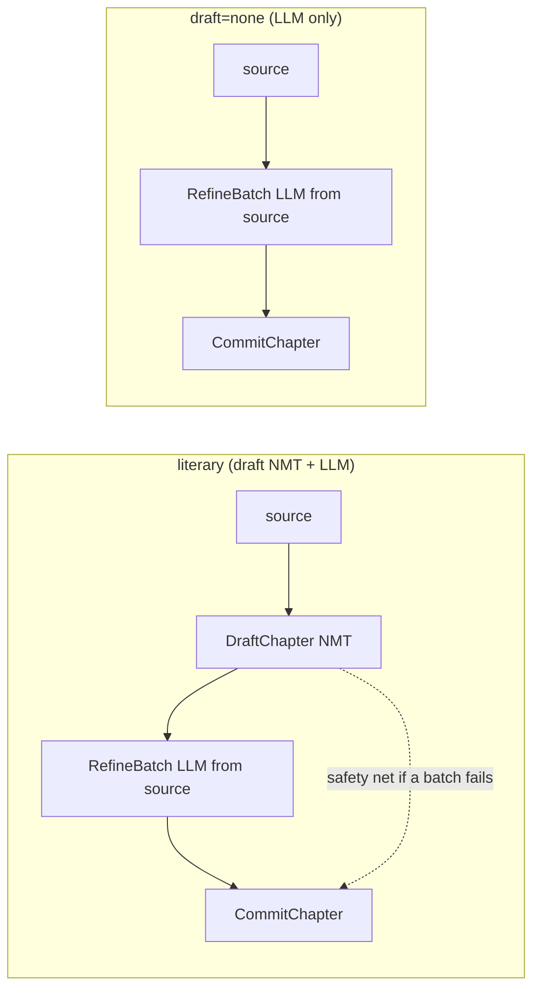

# RFC 0010: LLM-Only Literary Translation (`--no-draft`)

- Status: `draft`
- Authors: TBD
- Created: 2026-09-10
- Updated: 2026-09-11
- Related:
  - Architecture: `docs/ARCHITECTURE.md`
  - Milestones: `docs/milestones/`
  - Builds on: `0006-faithful-multivolume-translation.md`, `0007-google-translate-draft-and-token-cost-model.md`
  - Depends on: `0009-temporal-execution-engine.md` (phase 1 ports/stages — the symbols this plan targets)
  - Supersedes: n/a
  - Superseded by: n/a

## Context

We want to be able to translate a book **using only an AI model** and do the
literary pass **at the same time** (a single LLM pass instead of an NMT draft
followed by a rewrite).

The `literary` mode is two-pass: an NMT draft then an LLM rewrite. Since the
RFC 0009 refactor (phase 1), these two passes are **stages** (`Stages`) chained
by the `literaryMode.Chapter` recipe
(`internal/pipeline/modes.go`): `Resolve -> Draft -> Refine x n -> Commit`.
Point verified in the code: **the LLM translates from the source, not the
draft**.

- `Stages.RefineBatch` (`internal/pipeline/stages.go`) calls
  `literary.TranslateBatch`, whose `buildPayload`
  (`internal/literary/translator.go`) sends `source_text` per segment, the full
  chapter source living in the cacheable prefix (`stablePrefix`,
  `internal/literary/prompt.go`).
- `draft_text` (`requestSegment.DraftText`) is only a **hint** in the prompt.
- The NMT draft (`Stages.DraftChapter`) serves mainly as a **safety net**:
  `literary.applyTargets` falls back to the draft when a batch fails or breaks
  the placeholders; the segment stays `StatusTranslated` and is **not
  persisted** (so it remains resumable).

In other words: "LLM only + literary at the same time" = **literary recipe
without the `DraftChapter` stage**. The ports architecture is already ~95%
there: the recipe composes stages, you just skip one.

## Goals

- Translate an EPUB with the LLM alone, with no NMT call, the literary quality
  (bible, glossary, style) applied in the same pass.
- Require no NMT credential when no NMT call will occur, as per the
  `RequiresAPIKey`/`estimate` invariant.
- Align estimation and runtime billing for this path.

## Non-Goals

- Introduce a third translation loop. Project memory sets in stone that "two
  loops cover 100% of translation time"; we add an **axis** (draft source), not
  a mode.
- Change the glossary contract, the QA gate, the budget, or the artifact format.

## Options Considered

### Option A: `--no-draft` flag (`draft = nmt | none` axis on the `literary` mode)
- Pros:
  - Reuses the whole literary recipe (bible, glossary tokens, batching, budget,
    ledger, QA gate) as-is; minimal delta.
  - Persistence unchanged in `EngineLiterary` -> **same TM space** as classic
    literary, reusable both ways, consistent with the per-mode reuse predicate
    (`Mode.ReusesDrafts`).
- Cons:
  - A single mode carries two behaviors; the CLI surface is a flag, not a
    visible mode.

### Option B: new `--mode llm` mode
- Pros:
  - Explicit CLI surface.
- Cons:
  - Duplicates `literaryMode` (recipe + projection + pricing) for a one-line
    delta.
  - Fragments the TM space (`EngineLLM` != `EngineLiterary`).
  - Contradicts the "two loops" principle.

## Proposed Decision

**Option A.** A `--no-draft` flag (and the `TOMESHIFT_LITERARY_DRAFT` env)
which, in `none`, skips the `DraftChapter` stage: the LLM translates directly
from `source_text`. Chosen degradation policy: **degrade to source** (untranslated
segment, counted by QA, not persisted, resumed by `--resume`) — refined by the
refactor's chapter guardrail (see §Impact).

## Implementation Plan

The anchors below target the RFC 0009 ports architecture (phase 1).

### Config — `internal/config/config.go`
1. Add `LiteraryDraft string` (env `TOMESHIFT_LITERARY_DRAFT`, default `nmt`),
   validated in `{nmt, none}` with a sentinel in `internal/config/errors.go`.
2. Expose `--no-draft` on `run` and `literary` (`internal/cli`); the flag forces
   `none` and takes precedence over the env, like the other flags.

### Flow contract — `internal/pipeline/types.go`
3. Add `LiteraryDraft string` to **`BookInput`** (and not to an old `RunConfig`,
   removed by the refactor). `commandexec` fills it from the config.

### Recipe — `internal/pipeline/modes.go`
4. `literaryMode.Chapter`: call `f.draft(ch, plan.Fresh, false)` only if
   `draft == nmt`. In `none`, the recipe becomes `Resolve -> Refine x n ->
   Commit`. The `draft` choice is read from `f.in.LiteraryDraft`.

### Accumulation — `internal/pipeline/book.go`
5. In `none`, `f.draft` is not called: `NMTSegments` and `NMTChars` stay 0 (no
   `DraftChapter`, hence no NMT counter delta). Fresh segments are already
   counted on the LLM side by `f.refine` via `LLMPassSegments`. Nothing else to
   change in the accumulation.

### Stages — `internal/pipeline/stages.go`
6. `DraftChapter` is simply not invoked in `none`; `Stages.Translator` can stay
   nil. Verify the literary paths that touch the translator: `nmtEngine()` and
   `charsSent()` already handle a nil translator (returning `""` / 0);
   `RefineBatch`/`CommitChapter`/`ProjectCost` do not dereference it.
7. Cost: `projectMode`/`costLiterary`/`literaryPass` (`stages.go`) drop the NMT
   draft component in `none` (cost = LLM tokens only, `NMTChars = 0`).

### Wiring — `internal/commandexec/translate.go` + `estimate.go`
8. `newStages`: no longer require an NMT endpoint/key when
   `mode == literary && draft == none`, and do not build the NMT provider
   (leave `Stages.Translator` nil). Same invariant as `RequiresAPIKey`/`estimate`:
   no secret demanded for a call that will not happen.
9. `estimate` (`Stages.Plan`): build the NMT `Translator` only if an NMT draft
   will occur, otherwise the LLM-only estimation demands the Google key we just
   eliminated.

### Global cost — `internal/cost/estimate.go`
10. `EstimateScenarios`: the `none` projection aligns with the full-LLM scenario
    (no NMT component), so that `estimate --mode literary --no-draft` matches
    runtime billing.

## Rollout Plan

- Local first: `estimate --mode literary --no-draft` (zero calls), then a run on
  a short volume with an LLM (OpenAI-compatible endpoint or the Claude CLI).
- Safety: `nmt` stays the default; `none` is opt-in.
- Rollback: removing the flag/env leaves the literary mode intact.

## Impact

### Technical
- Without a draft, a failed LLM batch leaves its segments **on the source**
  (untranslated) instead of a readable NMT. Two regimes, inherited from the
  refactor:
  - **Partial degradation**: some batches succeed, others do not -> the failed
    segments stay source, `StatusTranslated`, not persisted, counted by QA
    (`UntranslatedSegments`), resumed by `--resume`.
  - **Fully failed chapter**: if **no** segment of a chapter is refined,
    `flow.refine` returns `ErrChapterUnrefined`
    (`internal/pipeline/errors.go`) and **the run fails outright** — we do not
    deliver a source chapter disguised as finished. This is a hardening relative
    to the original "degrade silently", and it lands perfectly for LLM-only.
- Literary recipe reused without duplication; one stage skipped.

### Cost
- `NMTChars = 0` on this path; cost driven by LLM tokens. The Google free tier
  no longer comes into play.

### Security/Compliance
- No NMT credential required in `none`; one less secret to load.

## Acceptance Criteria

- `none`: no NMT call emitted (`Stages.Translator` nil, `DraftChapter` not
  invoked), the LLM translates from the source, complete output.
- Partial degradation: a failed LLM batch leaves its segments on source,
  `StatusTranslated`, not persisted, counted by QA; `--resume` resumes them.
- Fully failed chapter in `none` -> `ErrChapterUnrefined`, run fails (no silent
  delivery).
- Startup without an NMT credential succeeds in `none` (mirror of the existing
  `estimate` test); still fails in `nmt`.
- Projection/`estimate` in `none`: `NMTChars = 0`, cost = LLM tokens;
  estimation == runtime.
- Glossary `<g id>` preserved without the draft (`Protect`/`Apply` contract
  unchanged).

## Risks and Mitigations

- Risk: a nil `Stages.Translator` dereference on an unforeseen literary path.
  - Mitigation: audit of translator usages in literary mode + a literary
    `RunBook` test with `Stages.Translator == nil` and `draft == none`.
- Risk: estimation/runtime divergence if only one of the two cost paths
  (`stages.go` vs `cost.EstimateScenarios`) is updated.
  - Mitigation: cross-test `estimate` vs run on the same book in `none`.
- Risk: unexpected interaction with the `ErrChapterUnrefined` guardrail.
  - Mitigation: recipe test where all batches of a chapter degrade in `none` ->
    run fails, spend recorded.

## Open Questions

- Should we keep `draft_text` (empty) in the payload in `none`, or omit it to
  save tokens? (Cosmetic, decision at implementation time.)

## Documentation (living docs — same change)

- `docs/usage.html`: `--no-draft` in §6 (flags table) **and** the `FLAGS` array
  (processing category); `TOMESHIFT_LITERARY_DRAFT` in §8; `--mode`/pipeline
  values in §5-6.
- `docs/understanding-the-project.html`: pipeline widget §1 (the two paths);
  invariant §13 ("draft = safety net, not translation source"; and "an LLM-only
  chapter with no refinement at all fails, it does not degrade silently").
- `docs/ARCHITECTURE.md` if the degradation contract evolves.
- `just docs-audit` must pass; new session in `docs/journal.html`.

## Decision Log

- 2026-09-10: created as `draft`. Choices validated in session: Option A
  (`--no-draft`), degradation to source, scope = analysis (implementation to
  follow).
- 2026-09-11: renumbered 0009 -> 0010 (collision with the Temporal engine RFC)
  and implementation plan rewired onto the RFC 0009 phase 1 ports architecture
  (`BookInput`, `modes.go`, `stages.go`, `DraftChapter`/`RefineBatch`,
  `ErrChapterUnrefined`). Decisions unchanged.
