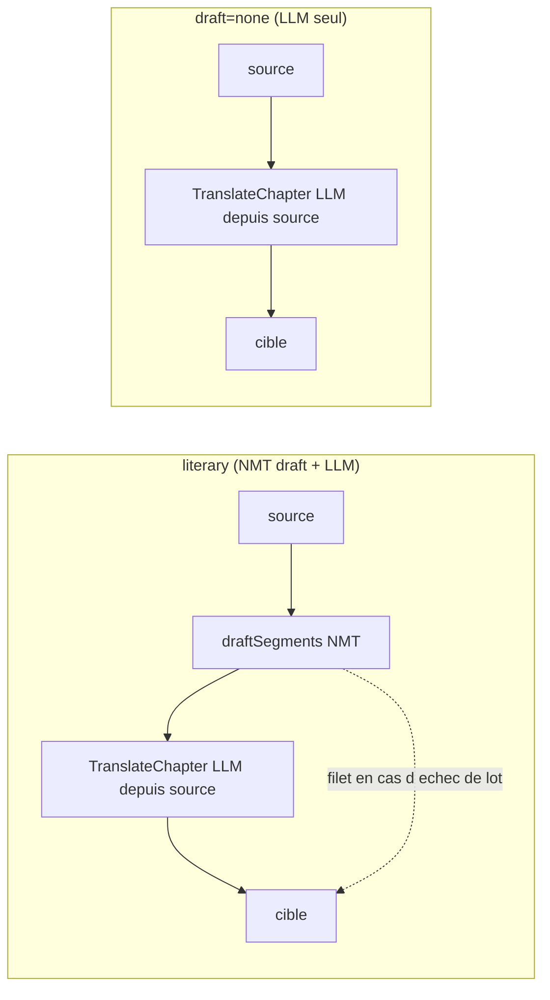

# RFC 0010: LLM-Only Literary Translation (`--no-draft`)

- Status: `draft`
- Authors: TBD
- Created: 2026-09-10
- Updated: 2026-09-10
- Related:
  - Architecture: `docs/ARCHITECTURE.md`
  - Milestones: `docs/milestones/`
  - Supersedes: n/a
  - Superseded by: n/a
  - Builds on: `0006-faithful-multivolume-translation.md`, `0007-google-translate-draft-and-token-cost-model.md`

## Context

On veut pouvoir traduire un livre **uniquement avec un modèle d'IA** et, si possible,
faire la passe littéraire **en même temps** (un seul temps LLM au lieu de
brouillon NMT puis réécriture).

Le mode `literary` est déjà un deux-temps : brouillon NMT (`draftSegments`, un
appel `TranslateBatch`) → réécriture LLM (`TranslateChapter`). Point vérifié
dans le code : **le LLM traduit à partir de la source, pas du brouillon**.

- `buildPayload` (`internal/literary/translator.go:393`) envoie `source_text` par
  segment + la source intégrale du chapitre dans le préfixe cacheable
  (`stablePrefix`, `internal/literary/prompt.go:96`).
- `draft_text` (`requestSegment.DraftText`) n'est qu'un **indice** dans le prompt.
- Le brouillon NMT sert surtout de **filet** : `TranslateChapter:266-268` — si un
  lot échoue ou renvoie du vide, le segment retombe sur `state.draft` en
  `StatusTranslated` et **n'est pas persisté** (donc reprenable).

Autrement dit : « LLM seul + littéraire en même temps » = **mode littéraire sans
l'étape brouillon NMT**. L'architecture y est déjà à ~90 %.

## Goals

- Traduire un EPUB avec le seul LLM, sans aucun appel NMT, la qualité littéraire
  (bible, glossaire, style) appliquée dans la même passe.
- Ne réclamer aucun credential NMT quand aucun appel NMT n'aura lieu, comme
  l'invariant `RequiresAPIKey`/`estimate`.
- Aligner estimation et facturation runtime pour ce chemin.

## Non-Goals

- Introduire une troisième boucle de traduction. La mémoire projet fige « deux
  boucles couvrent 100 % du temps de traduction » ; on ajoute un **axe** (source
  du brouillon), pas un mode.
- Changer le contrat glossaire, la QA gate, le budget, ou le format des
  artefacts.

## Options Considered

### Option A: flag `--no-draft` (axe `draft = nmt | none` sur le mode `literary`)
- Pros:
  - Réutilise toute la boucle littéraire (bible, tokens glossaire, batching,
    budget, ledger, QA gate) telle quelle ; delta minimal.
  - Persistance inchangée en `EngineLiterary` → **même espace TM** que le
    littéraire classique, réutilisable dans les deux sens, cohérent avec le
    prédicat de réutilisation par mode.
- Cons:
  - Un seul mode porte deux comportements ; la surface CLI est un flag, pas un
    mode visible.

### Option B: nouveau mode `--mode llm`
- Pros:
  - Surface CLI explicite.
- Cons:
  - Duplique `literaryMode` (Project/Cost/pass/Translate) pour un delta d'une
    ligne.
  - Fragmente l'espace TM (`EngineLLM` ≠ `EngineLiterary`).
  - Contredit le principe « deux boucles ».

## Proposed Decision

**Option A.** Un flag `--no-draft` (et l'env `EPUB_TRANSLATOR_LITERARY_DRAFT`)
qui, en `none`, saute `draftSegments` : le LLM traduit directement depuis
`source_text`. Politique de dégradation retenue : **dégrader vers la source**
(segment non traduit, compté par la QA, non persisté, repris par `--resume`).

## Implementation Plan

### Config — `internal/config/config.go`
1. Ajouter `LiteraryDraft string` (env `EPUB_TRANSLATOR_LITERARY_DRAFT`, défaut
   `nmt`), validé ∈ `{nmt, none}` avec sentinelle dans `internal/config/errors.go`.
2. Exposer `--no-draft` sur `run` et `literary` (`internal/cli`) ; le flag force
   `none` et l'emporte sur l'env, comme les autres flags.

### Wiring — `internal/commandexec/translate.go`
3. `newOrchestrator:63-72` : ne plus exiger endpoint/clé NMT quand
   `mode == literary && draft == none`. Même invariant que
   `RequiresAPIKey`/`estimate` : pas de secret réclamé pour un appel qui n'aura
   pas lieu.
4. En `none`, ne pas construire le provider NMT (`Translator` peut rester nil,
   `draftSegments` n'étant pas appelé). Vérifier qu'aucun autre chemin
   littéraire ne le déréférence.
5. Propager le choix jusqu'à `RunConfig` (nouveau champ `LiteraryDraft` dans
   `internal/pipeline/types.go`).

### Boucle — `internal/pipeline/mode.go`
6. `literaryMode` porte le choix `draft`. Dans `Translate:256`, garder
   `draftSegments` seulement si `draft == nmt`.
7. `Translate:259-262` : en `none`, ne pas incrémenter `NMTSegments` ; compter
   ces segments côté LLM, `NMTEngine` vide, `NMTChars = 0`.
8. `fallbackText` renverra vide → la dégradation vers source est déjà gérée par
   `TranslateChapter:266-268` (segment `StatusTranslated` non persisté, QA le
   compte, `--resume` retente). Rien à changer dans `internal/literary`.

### Coût — `internal/pipeline/mode.go` + `internal/cost`
9. `literaryMode.Project`/`Cost`/`pass` (`mode.go:150-198`) : en `none`, retirer
   la composante brouillon NMT (coût = tokens LLM seuls).
10. Miroir dans `cost.EstimateScenarios` pour que
    `estimate --mode literary --no-draft` == facturation runtime.
11. `internal/commandexec/estimate.go:30` construit un `Translator` NMT
    inconditionnellement : le rendre conditionnel en `none`, sinon l'estimation
    LLM-only réclame la clé Google qu'on vient d'éliminer.

## Rollout Plan

- Local d'abord : `estimate --mode literary --no-draft` (zéro appel), puis un run
  sur un tome court avec un LLM local (`cmd/nmt-devserver` n'est pas concerné ;
  utiliser un endpoint OpenAI-compatible ou le CLI Claude).
- Safety : `nmt` reste le défaut ; `none` est opt-in.
- Rollback : retirer le flag/env laisse le mode littéraire intact.

## Impact

### Technical
- Un lot LLM en échec sans brouillon laisse le segment sur sa source (non
  traduit) au lieu d'un NMT lisible. Comportement voulu, compté par la QA,
  reprenable.
- Boucle littéraire réutilisée sans duplication.

### Cost
- `NMTChars = 0` sur ce chemin ; coût piloté par les tokens LLM. Le palier
  gratuit Google n'entre plus en jeu.

### Security/Compliance
- Aucun credential NMT requis en `none` ; un secret de moins à charger.

## Acceptance Criteria

- `none` : aucun `TranslateBatch` NMT émis (provider nil/mort), le LLM traduit
  depuis la source, sortie complète.
- Un lot LLM en échec sans brouillon → segment reste source, `StatusTranslated`,
  non persisté, compté QA ; `--resume` le reprend.
- Démarrage sans credential NMT réussit en `none` (miroir du test `estimate`
  existant) ; échoue toujours en `nmt`.
- Projection/`estimate` en `none` : `NMTChars = 0`, coût = tokens LLM ;
  estimation == runtime.
- Glossaire `<g id>` préservé sans le brouillon.

## Risks and Mitigations

- Risk: un déréférencement `Translator` nil sur un chemin littéraire non prévu.
  - Mitigation: audit des usages de `o.Translator` en mode littéraire + test avec
    provider nil.
- Risk: divergence estimation/runtime si un seul des deux chemins de coût est
  mis à jour.
  - Mitigation: test croisé `estimate` vs run sur le même livre en `none`.

## Open Questions

- Faut-il conserver `draft_text` (vide) dans le payload en `none`, ou l'omettre
  pour économiser des tokens ? (Cosmétique, décision à l'implémentation.)

## Documentation (living docs — même changement)

- `docs/utilisation.html` : `--no-draft` en §6 (table des flags) **et** l'array
  `FLAGS` (catégorie processing) ; `EPUB_TRANSLATOR_LITERARY_DRAFT` en §8 ;
  valeurs `--mode`/pipeline en §5-6.
- `docs/comprendre-le-projet.html` : widget pipeline §1 (les deux chemins) ;
  invariant §13 (« brouillon = filet, pas source de traduction »).
- `docs/ARCHITECTURE.md` si le contrat de dégradation évolue.
- `just docs-audit` doit passer ; nouvelle session dans `docs/journal.html`.

## Decision Log

- 2026-09-10: création en `draft`. Choix validés en session : Option A
  (`--no-draft`), dégradation vers la source, périmètre = analyse (implémentation
  à suivre).
