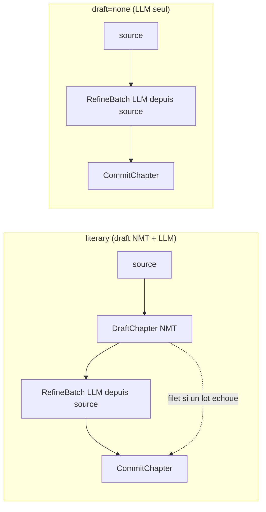

# RFC 0010: LLM-Only Literary Translation (`--no-draft`)

- Status: `draft`
- Authors: TBD
- Created: 2026-09-10
- Updated: 2026-09-11
- Related:
  - Architecture: `docs/ARCHITECTURE.md`
  - Milestones: `docs/milestones/`
  - Builds on: `0006-faithful-multivolume-translation.md`, `0007-google-translate-draft-and-token-cost-model.md`
  - Depends on: `0009-temporal-execution-engine.md` (phase 1 ports/stages — the symbols this plan targets)
  - Supersedes: n/a
  - Superseded by: n/a

## Context

On veut pouvoir traduire un livre **uniquement avec un modèle d'IA** et faire la
passe littéraire **en même temps** (un seul temps LLM au lieu de brouillon NMT
puis réécriture).

Le mode `literary` est un deux-temps : brouillon NMT puis réécriture LLM. Depuis
le refactor RFC 0009 (phase 1), ces deux temps sont des **étapes** (`Stages`)
enchaînées par la recette `literaryMode.Chapter`
(`internal/pipeline/modes.go`) : `Resolve -> Draft -> Refine x n -> Commit`.
Point vérifié dans le code : **le LLM traduit à partir de la source, pas du
brouillon**.

- `Stages.RefineBatch` (`internal/pipeline/stages.go`) appelle
  `literary.TranslateBatch`, dont `buildPayload`
  (`internal/literary/translator.go`) envoie `source_text` par segment, la source
  intégrale du chapitre étant dans le préfixe cacheable (`stablePrefix`,
  `internal/literary/prompt.go`).
- `draft_text` (`requestSegment.DraftText`) n'est qu'un **indice** dans le prompt.
- Le brouillon NMT (`Stages.DraftChapter`) sert surtout de **filet** :
  `literary.applyTargets` retombe sur le brouillon quand un lot échoue ou casse
  les placeholders ; le segment reste `StatusTranslated` et **n'est pas
  persisté** (donc reprenable).

Autrement dit : « LLM seul + littéraire en même temps » = **recette littéraire
sans l'étape `DraftChapter`**. L'architecture à ports y est déjà à ~95 % : la
recette compose des étapes, il suffit d'en sauter une.

## Goals

- Traduire un EPUB avec le seul LLM, sans aucun appel NMT, la qualité littéraire
  (bible, glossaire, style) appliquée dans la même passe.
- Ne réclamer aucun credential NMT quand aucun appel NMT n'aura lieu, comme
  l'invariant `RequiresAPIKey`/`estimate`.
- Aligner estimation et facturation runtime pour ce chemin.

## Non-Goals

- Introduire une troisième boucle de traduction. La mémoire projet fige « deux
  boucles couvrent 100 % du temps de traduction » ; on ajoute un **axe** (source
  du brouillon), pas un mode.
- Changer le contrat glossaire, la QA gate, le budget, ou le format des
  artefacts.

## Options Considered

### Option A: flag `--no-draft` (axe `draft = nmt | none` sur le mode `literary`)
- Pros:
  - Réutilise toute la recette littéraire (bible, tokens glossaire, batching,
    budget, ledger, QA gate) telle quelle ; delta minimal.
  - Persistance inchangée en `EngineLiterary` -> **même espace TM** que le
    littéraire classique, réutilisable dans les deux sens, cohérent avec le
    prédicat de réutilisation par mode (`Mode.ReusesDrafts`).
- Cons:
  - Un seul mode porte deux comportements ; la surface CLI est un flag, pas un
    mode visible.

### Option B: nouveau mode `--mode llm`
- Pros:
  - Surface CLI explicite.
- Cons:
  - Duplique `literaryMode` (recette + projection + pricing) pour un delta d'une
    ligne.
  - Fragmente l'espace TM (`EngineLLM` != `EngineLiterary`).
  - Contredit le principe « deux boucles ».

## Proposed Decision

**Option A.** Un flag `--no-draft` (et l'env `EPUB_TRANSLATOR_LITERARY_DRAFT`)
qui, en `none`, saute l'étape `DraftChapter` : le LLM traduit directement depuis
`source_text`. Politique de dégradation retenue : **dégrader vers la source**
(segment non traduit, compté par la QA, non persisté, repris par `--resume`) —
affinée par le garde-fou chapitre du refactor (voir §Impact).

## Implementation Plan

Les ancres ci-dessous visent l'architecture à ports de la RFC 0009 (phase 1).

### Config — `internal/config/config.go`
1. Ajouter `LiteraryDraft string` (env `EPUB_TRANSLATOR_LITERARY_DRAFT`, défaut
   `nmt`), validé dans `{nmt, none}` avec une sentinelle dans
   `internal/config/errors.go`.
2. Exposer `--no-draft` sur `run` et `literary` (`internal/cli`) ; le flag force
   `none` et l'emporte sur l'env, comme les autres flags.

### Contrat de flux — `internal/pipeline/types.go`
3. Ajouter `LiteraryDraft string` à **`BookInput`** (et non à un ancien
   `RunConfig`, supprimé par le refactor). `commandexec` le renseigne depuis la
   config.

### Recette — `internal/pipeline/modes.go`
4. `literaryMode.Chapter` : n'appeler `f.draft(ch, plan.Fresh, false)` que si
   `draft == nmt`. En `none`, la recette devient `Resolve -> Refine x n ->
   Commit`. Le choix `draft` est lu depuis `f.in.LiteraryDraft`.

### Accumulation — `internal/pipeline/book.go`
5. En `none`, `f.draft` n'est pas appelé : `NMTSegments` et `NMTChars` restent 0
   (aucun `DraftChapter`, donc aucun delta de compteur NMT). Les segments frais
   sont déjà comptés côté LLM par `f.refine` via `LLMPassSegments`. Rien d'autre
   à changer dans l'accumulation.

### Étapes — `internal/pipeline/stages.go`
6. `DraftChapter` n'est tout simplement pas invoqué en `none` ; `Stages.Translator`
   peut rester nil. Vérifier les chemins littéraires qui touchent le translator :
   `nmtEngine()` et `charsSent()` gèrent déjà un translator nil (retour `""` / 0) ;
   `RefineBatch`/`CommitChapter`/`ProjectCost` ne le déréférencent pas.
7. Coût : `projectMode`/`costLiterary`/`literaryPass` (`stages.go`) retirent la
   composante brouillon NMT en `none` (coût = tokens LLM seuls, `NMTChars = 0`).

### Wiring — `internal/commandexec/translate.go` + `estimate.go`
8. `newStages` : ne plus exiger endpoint/clé NMT quand
   `mode == literary && draft == none`, et ne pas construire le provider NMT
   (laisser `Stages.Translator` nil). Même invariant que `RequiresAPIKey`/`estimate` :
   pas de secret réclamé pour un appel qui n'aura pas lieu.
9. `estimate` (`Stages.Plan`) : ne construit le `Translator` NMT que si un
   brouillon NMT aura lieu, sinon l'estimation LLM-only réclame la clé Google
   qu'on vient d'éliminer.

### Coût global — `internal/cost/estimate.go`
10. `EstimateScenarios` : la projection `none` s'aligne sur le scénario full-LLM
    (aucune composante NMT), pour que `estimate --mode literary --no-draft` égale
    la facturation runtime.

## Rollout Plan

- Local d'abord : `estimate --mode literary --no-draft` (zéro appel), puis un run
  sur un tome court avec un LLM (endpoint OpenAI-compatible ou le CLI Claude).
- Safety : `nmt` reste le défaut ; `none` est opt-in.
- Rollback : retirer le flag/env laisse le mode littéraire intact.

## Impact

### Technical
- Sans brouillon, un lot LLM en échec laisse ses segments **sur la source** (non
  traduits) au lieu d'un NMT lisible. Deux régimes, hérités du refactor :
  - **Dégradation partielle** : certains lots réussissent, d'autres non -> les
    segments ratés restent source, `StatusTranslated`, non persistés, comptés par
    la QA (`UntranslatedSegments`), repris par `--resume`.
  - **Chapitre entièrement raté** : si **aucun** segment d'un chapitre n'est
    raffiné, `flow.refine` renvoie `ErrChapterUnrefined`
    (`internal/pipeline/errors.go`) et **le run échoue franchement** — on ne livre
    pas un chapitre de source déguisé en fini. C'est un durcissement par rapport
    au « dégrader en silence » d'origine, et il tombe pile pour le LLM-only.
- Recette littéraire réutilisée sans duplication ; une étape sautée.

### Cost
- `NMTChars = 0` sur ce chemin ; coût piloté par les tokens LLM. Le palier
  gratuit Google n'entre plus en jeu.

### Security/Compliance
- Aucun credential NMT requis en `none` ; un secret de moins à charger.

## Acceptance Criteria

- `none` : aucun appel NMT émis (`Stages.Translator` nil, `DraftChapter` non
  invoqué), le LLM traduit depuis la source, sortie complète.
- Dégradation partielle : un lot LLM en échec laisse ses segments en source,
  `StatusTranslated`, non persistés, comptés QA ; `--resume` les reprend.
- Chapitre entièrement raté en `none` -> `ErrChapterUnrefined`, run en échec (pas
  de livraison silencieuse).
- Démarrage sans credential NMT réussit en `none` (miroir du test `estimate`
  existant) ; échoue toujours en `nmt`.
- Projection/`estimate` en `none` : `NMTChars = 0`, coût = tokens LLM ;
  estimation == runtime.
- Glossaire `<g id>` préservé sans le brouillon (contrat `Protect`/`Apply`
  inchangé).

## Risks and Mitigations

- Risk: un déréférencement `Stages.Translator` nil sur un chemin littéraire non
  prévu.
  - Mitigation: audit des usages du translator en mode littéraire + un test
    `RunBook` littéraire avec `Stages.Translator == nil` et `draft == none`.
- Risk: divergence estimation/runtime si un seul des deux chemins de coût
  (`stages.go` vs `cost.EstimateScenarios`) est mis à jour.
  - Mitigation: test croisé `estimate` vs run sur le même livre en `none`.
- Risk: interaction inattendue avec le garde-fou `ErrChapterUnrefined`.
  - Mitigation: test de recette où tous les lots d'un chapitre dégradent en
    `none` -> run en échec, dépense enregistrée.

## Open Questions

- Faut-il conserver `draft_text` (vide) dans le payload en `none`, ou l'omettre
  pour économiser des tokens ? (Cosmétique, décision à l'implémentation.)

## Documentation (living docs — même changement)

- `docs/utilisation.html` : `--no-draft` en §6 (table des flags) **et** l'array
  `FLAGS` (catégorie processing) ; `EPUB_TRANSLATOR_LITERARY_DRAFT` en §8 ;
  valeurs `--mode`/pipeline en §5-6.
- `docs/comprendre-le-projet.html` : widget pipeline §1 (les deux chemins) ;
  invariant §13 (« brouillon = filet, pas source de traduction » ; et « un
  chapitre LLM-only sans aucun raffinement échoue, il ne se dégrade pas en
  silence »).
- `docs/ARCHITECTURE.md` si le contrat de dégradation évolue.
- `just docs-audit` doit passer ; nouvelle session dans `docs/journal.html`.

## Decision Log

- 2026-09-10: création en `draft`. Choix validés en session : Option A
  (`--no-draft`), dégradation vers la source, périmètre = analyse (implémentation
  à suivre).
- 2026-09-11: renuméroté 0009 -> 0010 (collision avec la RFC du moteur Temporal)
  et plan d'implémentation recâblé sur l'architecture à ports de la RFC 0009
  phase 1 (`BookInput`, `modes.go`, `stages.go`, `DraftChapter`/`RefineBatch`,
  `ErrChapterUnrefined`). Décisions inchangées.
